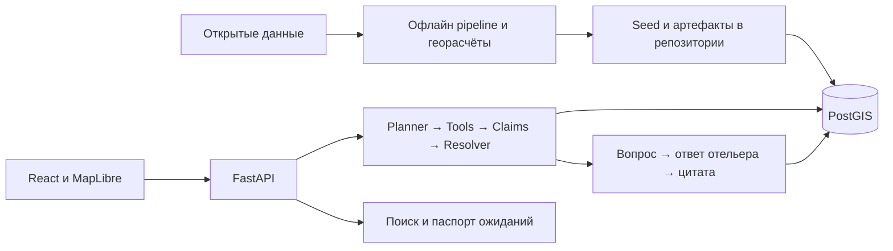

# О!кно — О!дин шаг до идеального отеля

О!кно пересобирает путь «хочу → бронь» в эпоху AI: поиск отелей Сочи по проверяемым характеристикам номера, фасада и этажа. Запрос превращается в понятные условия, каждый результат объясняется доказательствами, а ожидания передаются отельеру в паспорте.

- Скринкаст записан: около 3 минут, 1920×1080, 30 кадров/с, 11 сцен без ошибок. **URL публичного видео: ожидается от владельца до сдачи.** Локальный файл — `demo/okno-demo.mp4` (около 10 МБ, не входит в Git).
- Работают поиск, георасчёты, доказательства, сравнение, паспорт ожиданий, кабинет отельера, студия характеристик и пересчёт при изменениях. Проверки и оставшиеся пункты — в `docs/STATUS.md`.

## Быстрый старт

```sh
git clone <URL-репозитория-команды>
cd <repo>
cp .env.example .env
docker compose up --build
# Открыть http://localhost:8080
```

URL репозитория команды в `ostrovok-hackathon-2026` укажет владелец. Текущий личный origin `https://github.com/shttrkk/okoshko.git` не является адресом сдачи по правилам.

## Переиспользование: как встроить в Островок

О!кно можно подключать частями к каталогу, поиску и экстранету. HTTP-контракты описаны в [OpenAPI](http://localhost:8080/api/docs) и [CONTRACTS](docs/CONTRACTS.md). Примеры ниже используют уже загруженный отель; POST-запросы сохраняют обычные локальные прогоны и ответы.

```sh
BASE=http://localhost:8080
HOTEL_ID=osm-node-10058556917
```

**Обогащение контента.** `POST /api/runs` запускает планировщик и разрешённые инструменты для выбранных характеристик. `GET /api/runs/{run_id}` возвращает ход и результат, `GET /api/hotels/{hotel_id}` — материализованные facts, исходные claims и доказательства. Контракт: [runs](http://localhost:8080/api/docs#/runs), [каталог](http://localhost:8080/api/docs#/catalog).

```sh
curl -sS -X POST "$BASE/api/runs" -H 'Content-Type: application/json' \
  -d '{"hotel_id":"osm-node-10058556917","characteristic_ids":["sea_view","sunset_view"]}'
curl -sS "$BASE/api/runs/<run_id>"
curl -sS "$BASE/api/hotels/$HOTEL_ID"
```

**Ранжирование и объяснения поверх поиска.** `POST /api/search` возвращает разобранный запрос, ранжирование, verdicts и ссылки на доказательства. `POST /api/hotels/{hotel_id}/evaluate` применяет отредактированный `ParsedQuery` к одному отелю и возвращает `HotelDetail` с рекомендацией номера. Объяснения входят в ответы этих маршрутов. Контракт: [catalog](http://localhost:8080/api/docs#/catalog).

```sh
curl -sS -X POST "$BASE/api/search" -H 'Content-Type: application/json' \
  -d '{"text":"тихий номер с видом на закат недалеко от моря","limit":20}'
curl -sS -X POST "$BASE/api/hotels/$HOTEL_ID/evaluate" -H 'Content-Type: application/json' \
  -d '{"text":"закат из окна","month":9,"must":[{"characteristic_id":"sunset_view","label":"Закат из окна","value":true}]}'
```

Текущий `/api/search` ранжирует локальный каталог. Для существующей выдачи Островка адаптер должен сопоставить её hotel IDs с внутренними IDs О!кна и применить evaluate к кандидатам; пакетная оценка внешнего списка пока не реализована.

**Виджет вопросов в экстранете.** `POST /api/questions` создаёт или переиспользует вопрос. Кабинет получает его через `GET /api/hotelier/{hotel_id}`; свободный ответ проходит preview через `POST /api/questions/{question_id}/answer`, затем `POST /api/answers/{answer_id}/confirm` сохраняет claims с цитатами. Контракт: [hotelier](http://localhost:8080/api/docs#/hotelier). В локальном демо токен выдаёт `POST /api/hotelier/login` для `hotelier / hotelier123`; в примере `TOKEN`, `question_id` и `answer_id` заменяются значениями ответов.

```sh
curl -sS -X POST "$BASE/api/hotelier/login" -H 'Content-Type: application/json' \
  -d '{"username":"hotelier","password":"hotelier123"}'
curl -sS -X POST "$BASE/api/questions" -H 'Content-Type: application/json' \
  -d '{"hotel_id":"osm-node-10058556917","characteristic_id":"pets"}'
curl -sS -X POST "$BASE/api/questions/<question_id>/answer" \
  -H "Authorization: Bearer $TOKEN" -H 'Content-Type: application/json' \
  -d '{"text":"Синтетический ответ для демонстрации: принимаем собак до 30 кг за 1000 рублей за ночь.","synthetic":true}'
curl -sS -X POST "$BASE/api/answers/<answer_id>/confirm" -H "Authorization: Bearer $TOKEN"
```

**Актуализация и события.** `POST /api/changes/refresh` перепроверяет истёкшие наблюдения доступными локальными инструментами. `GET /api/changes` отдаёт события пересчёта, `GET /api/passports/{passport_id}` — состояние ожиданий и вложенные локальные уведомления. Для прогонов есть SSE `GET /api/runs/{run_id}/stream`. Контракт: [changes](http://localhost:8080/api/docs#/changes), [passports](http://localhost:8080/api/docs#/passports), [runs](http://localhost:8080/api/docs#/runs).

```sh
curl -sS -X POST "$BASE/api/changes/refresh"
curl -sS "$BASE/api/changes"
curl -sS "$BASE/api/passports/<passport_id>"
curl -N "$BASE/api/runs/<run_id>/stream"
```

Для production нужен адаптер внешних hotel IDs к `Hotel.id`, координатам и контурам; публичного API импорта отелей пока нет. Цены и номерной фонд следует получать из каталога Островка вместо `mock_basic_card`, а ответы симулятора — заменить ответами авторизованных представителей с сохранением цитат и происхождения. Уже параметризованы регион (`pipeline/regions/*.yaml`), характеристики (`data/characteristics/*.yaml`), OpenAI-compatible LLM и offline-режим. Карта модулей и ограничения интеграции — в [ARCHITECTURE](docs/ARCHITECTURE.md), пользовательская модель — в [PRODUCT](docs/PRODUCT.md).

До эксплуатации нужны изоляция арендаторов и SSO, разграничение прав на отели, долговечная очередь задач, квоты, мониторинг, резервное копирование и правила хранения персональных данных. Текущий демонстрационный вход не считается готовой авторизацией экстранета. Также нужны независимая проверка качества и коммерческая проверка лицензий, включая Ookla.

Время полного pipeline для 250 отелей Сочи по стадиям ещё не измерено. Старт приложения за 46 с не является временем сбора или расчёта региона; оценку стоимости и ресурсов для 1000 отелей из него не выводим. Замеры загрузки источников, геообработки, LOS/Monte Carlo и валидации, а также нагрузочные тесты API нужны отдельно. Рекомендации по ресурсам ниже относятся к запуску поставленного демо.

## Зависимости и переменные окружения

Нужны Docker Desktop/Engine и Compose ≥2.24. Рекомендовано 4 CPU, 8 ГБ RAM и 10 ГБ диска с учётом сборки. Всё приложение работает в Docker: PostgreSQL 17 с PostGIS 3.6, Python 3.12/FastAPI и собранный интерфейс React/Vite/MapLibre. Версии базовых образов и зависимости закреплены; используются публичные реестры.

Образ приложения на контрольной точке 26.10.2026: 315 513 186 байт (около 301 MiB), `linux/amd64`. Запуск с пустой БД и готовым образом проверен за 46 с. Для snapshot `3e3cc92` чистый клон с пустым кэшем builder прошёл `docker compose up --build`: health через 139,49 с, полный прогон — 212,29 с, browser preview прошёл. В этом прогоне `.env` был скопирован из `.env.example`; отдельная проверка без `.env` ещё выполняется. Это замер запуска подготовленного демо, не пересборки региона.

| Переменная | Значение по умолчанию |
|---|---|
| APP_PORT | 8080; порт внутри контейнера и проброс фиксированы |
| DB_URL | postgresql://okno:okno@db:5432/okno |
| LLM_BASE_URL | https://api.openai.com/v1 |
| LLM_API_KEY | пусто |
| LLM_MODEL | пусто |
| LLM_MODE | offline |
| LLM_STRUCTURED_MODE | auto |
| LLM_TIMEOUT_S | 12 |

Ключ LLM необязателен. Основной сценарий работает без сети после сборки: детерминированные инструменты, русские правила и локальный кэш. Для опционального OpenAI-compatible провайдера задайте в локальном `.env` одновременно `LLM_MODE=live`, `LLM_MODEL` и `LLM_API_KEY`; при необходимости измените `LLM_BASE_URL`. LLM не создаёт фактические значения характеристик без доказательств.

## Сидирование

Миграции, загрузка подготовленных данных и построение поискового снимка выполняются автоматически до запуска HTTP. В поставке 250 отелей и 16 базовых спецификаций характеристик. Ещё 750 наблюдений о ближайших POI рассчитываются локально при первом старте по сохранённым открытым данным. Ключи и ручная загрузка данных не требуются.

`make pipeline` отдельно пересобирает открытые данные и георасчёты; для локального запуска он не нужен. Формат seed и реестр доказательств описаны в `docs/CONTRACTS.md` §3.

## Маршруты/доступ

- `/` — главная; `/search`, `/hotel/:id`, `/compare`, `/booking/:id` — путь гостя.
- `/hotelier`, `/studio`, `/agent`, `/changes`, `/quality`, `/quality/label`, `/sources` — кабинет, инструменты и проверка данных.
- `/health` — 200, `{"status":"ok"}`; `/api/docs` — OpenAPI.
- Тестовый отельер: `hotelier / hotelier123`. Это локальный демонстрационный доступ.

## Данные, лицензии и атрибуции

Данные взяты из открытых источников. Данные и скрапинг Островка, Booking и других OTA не используются. Ответы, добавленные симулятором отельера, явно отделены от открытых наблюдений. Источники, даты, SHA-256 и лицензии находятся в `data/seed/manifest.json`, `data/seed/sources.json` и на `/sources`; подробности — в `pipeline/README.md`.

В seed 250 реальных объектов: 175 в центре Сочи и 75 в Адлере–Имеретинке. Географический реестр содержит 20 340 claims, климат, воздух и Commons — 3 364. Дополнительно сохранены 40 коротких цитат с официальных сайтов для слабых меток качества. Внутренние свойства реальных гостиниц не выводятся из их названий или категории.

Использованы OSM/Geofabrik (ODbL), Overture (лицензия каждого набора), Copernicus GLO-30, Open-Meteo (CC BY 4.0), Wikidata (CC0), Commons (лицензия каждого файла), Ookla (CC BY-NC-SA, некоммерческий прототип) и Protomaps (ODbL для данных, BSD для кода). Сырые PBF и DEM не входят в Git. Базовые поля карточки могут быть демонстрационными (`mock_basic_card`). Симулятор отельера, оценка спроса, бронь и новая постройка помечаются как синтетические.

Демо-регион: **Сочи — центр и Адлер–Имеретинка**. Точные зоны указаны в `pipeline/regions/sochi.yaml` и в интерфейсе. Другие города требуют отдельной сборки: `make pipeline REGION=pipeline/regions/<region>.yaml`.

### Синтетические демонстрационные сценарии

В поставке три вымышленных ответа о тишине в сентябре: Cascade — юго-западный фасад, 3-й этаж; Приморская — западный фасад, 5-й этаж; Brevis — западный фасад, 7-й этаж. Они имеют `synthetic=true`, `evidence.kind=simulation`, точную цитату и публичный реестр `data/seed/demo_hotelier_claims.jsonl`. Это **не реальные ответы гостиниц и не измерение тишины**. Confidence исходного claim — 0,85; итогового факта после согласования Resolver — около 0,69. Исходная модель внешнего шума сохраняет confidence 0,38.

Закат и пеший маршрут этих отелей рассчитаны по открытым данным. Маршрут с confidence около 0,66 остаётся предварительной оценкой. В сценарии Маши три отеля попадают в группу «все обязательные»: группа допускает ✓ или ≈ с confidence ≥0,6 и совместимыми условиями номера. Неизвестные ограничения туда не попадают. Без дат показано предположение «Сентябрь (по умолчанию) — укажите даты».

Также включены семь завершённых синтетических диалогов о питомцах и два вопроса для прохождения петли в кабинете. В `data/seed/demo_hotelier_dialogues.json` сохранены вопросы, свободные ответы, разобранные поля, подтверждённые ответы симулятора, claims и трассы. Это не подтверждения от реальных отелей. Парковка рядом рассчитывается отдельно по открытым данным и не доказывает наличие собственной парковки или возможность въезда.

## Проверка за 5 минут

После запуска без ключа LLM:

1. На главной выберите сентябрь и введите «тихий номер с видом на закат недалеко от моря». Проверьте условия запроса, регион Сочи, три результата в группе «все обязательные» и метки синтетических ответов.
2. Включите слои заката, вида и шума. Откройте отель: найдите фасад, этаж, «да, но», ограничения и источник рядом с каждым фактом.
3. Откройте «Показать расчёт»: профиль горизонта, солнечный путь, неопределённость и входные данные. Сравните 2–3 отеля.
4. У неизвестной шумоизоляции нажмите «Спросить отель». Войдите в кабинет как `hotelier / hotelier123`, получите ответ симулятора, просмотрите поля с цитатами и подтвердите ответ. До подтверждения новые claims не создаются.
5. Создайте паспорт ожиданий. В кабинете подтвердите номер или предложите альтернативу; проверьте таймлайн. Если доказательства истекают раньше конца поездки, паспорт показывает необходимость перепроверки, а не гарантию будущих условий.
6. На `/changes` примените явно синтетический новый дом. Посмотрите пересчёт было/стало и локальное уведомление паспорту.
7. В `/studio` добавьте «искупаться до завтрака», выполните пробный расчёт и публикацию. На `/agent` видны инструменты и доказательства; `/quality` разделяет слабые метки сайтов, ручную разметку и синтетические тесты.

Приёмка из терминала: `make demo-check` проверяет Машу, пять персон, ссылки на доказательства и синтетическое происхождение ответов. `make smoke` дополнительно проходит health → поиск → карточка → сохранённый паспорт → авторизованный кабинет. Для этих локальных команд нужны Python 3.12 и `requirements-dev.lock`; установка описана в `docs/RUNBOOK.md`. Для запуска приложения достаточно Docker. Полный pytest: 308 тестов и 125 subtests прошли; lint и сборка интерфейса прошли. Проверки записаны в `docs/STATUS.md`.

## Как решение закрывает кейс

| Пункт кейса | Где реализуется | Как проверить |
|---|---|---|
| Ожидаемый результат: найти подходящий отель региона | `/search`, 250 объектов Сочи | Свободный запрос → ранжированные карточки |
| 1. Сбор характеристик | `geo/`, `pipeline/`, реестр инструментов, Planner | `/agent`: инструмент → claim → доказательство |
| 2. Диалог с отельером | Interviewer, AnswerParser, `/hotelier` | Вопрос → свободный ответ → цитаты → подтверждение симулятора |
| 3. Хранение и достоверность | PostgreSQL, Resolver | Источник, метод, confidence, срок действия и разбор условий фасада/этажа |
| 4. Расширяемость | YAML-спецификации, `/studio` | Компиляция → пробный расчёт → публикация → новый чип |
| 5. Поиск своими словами | QueryUnderstanding, Ranker, `/search` | Русский запрос и редактирование обязательных и желательных условий |
| Доп. 1: объяснения | Explainer, карточки и `/hotel/:id` | По каждому условию ✓ / ≈ / ✗ / ? с доказательствами |
| Доп. 2: сравнение | `/compare` | 2–4 отеля, различия и уверенность |
| Доп. 3: кабинет | `/hotelier` | Подтверждение или исправление создаёт новый claim с цитатой |
| Доп. 4: актуализация | FreshnessWatcher, `/changes` | Сроки действия и синтетический новый дом с географическим пересчётом |
| Доп. 5: метрики | `make eval`, `/quality`, `/quality/label` | Методика, слабые метки и отдельные результаты синтетических тестов |

## Безопасность зависимостей

`make check` запускает lint, тесты, аудит и smoke уже работающего Compose. `make audit` проверяет четыре Python lock-файла с хэшами: runtime, разработку и два окружения pipeline; ещё три скана покрывают npm production, полный frontend и запись демо. Аудит блокирует известные Python-уязвимости и npm High/Critical. Сбой сканера не считается успехом.

26.10.2026 все семь сканов завершились без известных уязвимостей и ошибок сканера. Дата, результаты и хэши находятся в `docs/audits/summary.json`; отчёт относится к указанным lock-файлам, а не является гарантией отсутствия будущих уязвимостей.

GitHub Actions в организации хакатона недоступны из-за биллинга. Workflow оставлен только для ручного запуска через `workflow_dispatch`, без push/PR-триггеров. Он использует dev lock, собирает Docker и запускает smoke вместе с demo-check. Локальные результаты и состояние проверки чистого клона — в `docs/STATUS.md`.

## Архитектура

Карта модулей, четыре сквозные цепочки и алгоритмы с допущениями: [docs/ARCHITECTURE.md](docs/ARCHITECTURE.md). Модель продукта, UX и контракты: [docs/PRODUCT.md](docs/PRODUCT.md).



## Метрики и ограничения

`make eval` воспроизводит `data/eval/results.json` из версионированных реестров; `/quality` дополнительно учитывает локальные POI и ручные действия. Синтетические факты не увеличивают реальное покрытие. Есть 40 слабых меток официальных сайтов для 40 разных объектов; четыре метки парковки ограничены по смыслу и не подтверждают все условия въезда. Независимых ручных меток — 0. nDCG, полевая точность и калибровка не измерены; диагностические результаты на слабых метках не выдаются за точность на реальных проверках.

Различия условий фасадов и этажей показаны отдельно от противоречий: в текущем наборе 109 квалификаций области действия, пересекающиеся диапазоны обрабатываются Resolver. Подтверждённых флагов конфликта высоты — 0; сравнение с моделью, использующей ту же высоту OSM, не считается независимой проверкой.

Monte Carlo показывает устойчивость к неопределённым входам, а не доказанную точность модели. Шум — приближённая наружная модель; шумоизоляцию нужно уточнять у отеля. Высоты зданий могут оцениваться по этажности, Copernicus — DSM с крышами и деревьями. Данных Ookla и Wikidata недостаточно для уверенных утверждений о Wi-Fi конкретного номера и истории здания. Фото Commons показывают окрестности с атрибуцией и не доказывают вид из окна.

Паспорт — структурированный демонстрационный запрос. Бронирование синтетическое, без оплаты; уведомления локальные, письма и сообщения гостиницам не отправляются. Текущие доказательства не гарантируют условия на будущие даты поездки.

Проверки и риски: `docs/STATUS.md`. Решения: `docs/DECISIONS.md`. Команды и порядок сдачи: `docs/RUNBOOK.md`.
