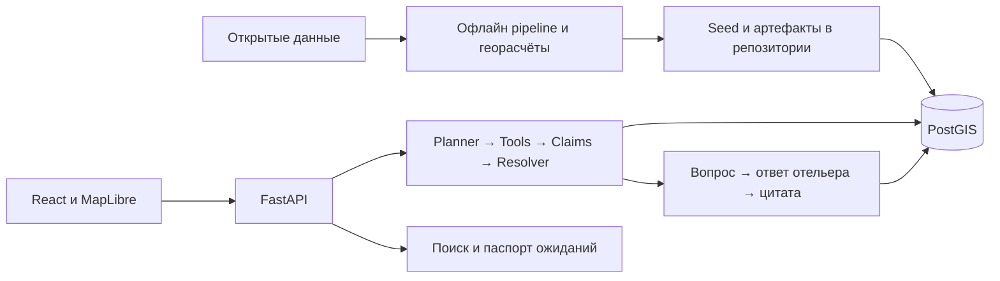

# О!кно — О!дин шаг до идеального отеля

О!кно пересобирает путь «хочу → бронь» в эпоху AI: поиск отелей Сочи по проверяемым характеристикам номера, фасада и этажа. Запрос превращается в понятные условия, каждый результат объясняется доказательствами, а ожидания передаются отельеру в паспорте.

- Видео: `<DEMO_VIDEO_URL>`. Скринкаст записан: около 3 минут, 1920×1080, 30 кадров/с, 11 сцен без ошибок. Локальный файл — `demo/okno-demo.mp4` (около 10 МБ, не входит в Git).
- Работают поиск, георасчёты, доказательства, сравнение, паспорт ожиданий, кабинет отельера, студия характеристик и пересчёт при изменениях. Проверки и оставшиеся пункты — в `docs/STATUS.md`.

## Быстрый старт

```sh
git clone <TEAM_REPOSITORY_URL>
cd <repo>
docker compose up --build
# Открыть http://localhost:8080
```

`.env` необязателен: дефолты запускают offline-демо. Чистый клон `f253c03` без `.env`, с пустым build cache: до `/health` 182,8 с, от старта контейнера 115,2 с, перезапусков 0; `make check`, все 18 проверок `demo-check` и все 20 browser smoke — PASS ([отчёт](docs/checks/tz_clean_clone.json)). Для изменения настроек можно скопировать `.env.example` в `.env`.

## Проверка за 5 минут

После `docker compose up --build`, без ключа LLM:

1. **Поиск.** Поле на главной пустое: нажмите «Демо-запрос» («тихий номер с видом на закат недалеко от моря»), чтобы заполнить его и сразу начать поиск. Есть не менее трёх вариантов в группе обязательных условий. Счётчик различает реальное подтверждение отеля, расчёт, демо-ответ, неточное, неизвестное и неподходящее. Демо-ответы помечены «Ответ отеля · демо» и показывают, как ответ меняет выдачу; подтверждением отеля они не считаются. Значок «≈» объясняется у заголовка группы. Введённые даты сохраняются при выборе примера.
2. **Карта.** Наведение на карточку подсвечивает отель. «Показать на карте» строит лучи обзора, заката и пеший маршрут до моря. Слои «Тишина / Закат / Вид / До моря» переключаются, зум — Ctrl/⌘ + колесо.
3. **Отель.** На странице отеля есть проверенное фото с указанием источника либо «Схема района, не фото». «Фото и отзывы на Яндекс Картах» открывает внешний поиск только по клику. «Какой номер просить» показывает совет под запрос и до четырёх целей по сторонам и этажам. У «Приморской» море — с 5-го этажа, а численная оценка шума на западе и юго-западе покрывает 1–5-й этажи и остаётся неточной. В «Подробнее» — короткое объяснение с числами, во вложенном «Для дотошных» — источники, методы, даты и ограничения. «Показать расчёт» показывает горизонт и путь солнца; «Проверить окно» меняет сторону, этаж и месяц. Существование и наличие конкретного номера подтвердит отель.
4. **Противоречия.** Откройте `/hotel/osm-way-53301256` («Фламинго»). Блок «Где данные спорят»: сайт обещает вид на море, расчёт по фасадам его не находит. Значение не считается подтверждённым, вопрос добавлен в локальный кабинет.
5. **Отельер.** Войдите в кабинет как `hotelier / hotelier123`: выбран отель с вопросами, очередь показывает оставшееся число и сортируется по числу поисков. Выберите вопрос. «Симулировать ответ» (или свой текст и «Разобрать ответ») → понятный разбор с дословными цитатами → «Подтвердить и показать гостям». Частичный ответ про животных, Wi-Fi или группы номеров сохраняет сообщённые условия и отмечает, что ещё не указано. Настоящий ответ виден гостю как «✓ Подтвердил отель», симуляция — «Ответ отеля · демо». «Создать новый ответ» исправляет тот же вопрос с сохранением истории. «Не знаю» закрывает вопрос без придуманного значения.
6. **Паспорт ожиданий.** «Создать паспорт» на странице отеля, затем подтверждение номера и комментария в кабинете. Сторона, этаж и месяц сохраняются. Дальняя поездка за пределами срока данных получает одну нейтральную строку «Перепроверим ближе к поездке»; сама по себе она не означает угрозу ожиданиям. Ответ отеля и проверенные по карте условия подписаны раздельно.
7. **Изменения.** На `/changes` уже лежит синтетический сценарий «рядом построили 16-этажный дом» у «Империи»: было/стало по фасадам и уведомление паспорту. Повторить сценарий для другого отеля можно под `hotelier / hotelier123` (роль `demo_admin`).
8. **Расширение и прозрачность.** В `/studio` выберите «Супермаркет в 5 минутах пешком» → спецификация → пробный прогон → публикация. Без ключа это офлайн-шаблоны для 15 типов мест OSM, с ключом — свободный текст. Пробный прогон проверяет до трёх отелей и отдельно показывает размер каталога: результат выборки не выдаётся за результат всех отелей. Служебные страницы собраны в меню «Для команды». На `/agent` открыт готовый прогон сбора профиля, исходные тексты поисковых запросов гостей скрыты из публичного API. На `/quality` — сравнение с фильтром «до моря ≤ 500 м» и происхождение значений.

9. **Компания в одном отеле.** Под полем поиска выберите пример «Едем компанией?» или введите «родителям тихий номер, нам вид на горы, всем до пляжа не больше 10 минут». Условия редактируются по запросам и отдельно «Для всех». «План номеров» проверяет каждое положение независимо. Он не подтверждает число свободных номеров, вместимость или соседство.
10. **Описание номера.** «Какой номер просить» объединяет расчётные советы, а выбранное положение открывается в «Проверить окно». Каждое утверждение раскрывается до факта. Неизвестная этажность остаётся условным уровнем; наличие окон и доступность номера нужно уточнить у отеля.

11. **Фото номеров.** Откройте `/hotel/osm-node-5267688942` (Liberty fly), нажмите «Фото номеров (7)». До нажатия изображения галереи не загружаются. У отелей без проверенных фото кнопки нет; если картинки недоступны, остаётся ссылка на сайт. Фото не привязываются к стороне, этажу или виду.

12. **О месте.** Попробуйте «круглосуточный магазин рядом», «из аэропорта без пересадок», «вид на Морской вокзал». В карточке отеля откройте «О месте»: минуты по пешему графу, источники и причины неизвестности. «Проверить окно» показывает сохранённый луч до выбранного объекта для известного этажа. У Фишта нет подтверждённой высоты — видимость неизвестна, луча нет. В `/studio` текст «вид на Морской вокзал» создаёт спецификацию и пробный расчёт без ключа.

Развитие к реальному расселению по датам, цене и номерному фонду описано в [GROUP_BOOKING](docs/GROUP_BOOKING.md). В текущих данных нет цен, кроватей и остатков, поэтому прототип их не рассчитывает.

Групповой разбор работает офлайн по правилам. Проверьте подписи, условия и границы этажей в редакторе: сложные длинные формулировки пока распознаются неполно. Авторские и независимо составленные наборы, включая слабые результаты обобщения, приведены в [STATUS](docs/STATUS.md) и `data/eval/group_validation_results.json`.

Ещё запросы: «с собакой 30 кг, нужна парковка», «в гуще событий, бары рядом», «похожий на Cascade», «тихо, море и закат в одном номере, 14–21 сентября», «удалённая работа, быстрый интернет». Последний показывает «≈», если на карте указан Wi-Fi; скорость при этом остаётся неизвестной. Пустая запись или отсутствие измерений не превращаются в утверждение о качестве интернета.

Приёмка разбора компании: `make group-parser-eval` (авторский набор и отдельные ловушки). Приёмка из терминала: `make demo-check` проверяет Машу, пять персон, ссылки на доказательства и синтетическое происхождение ответов. `make smoke` дополнительно проходит health → поиск → карточка → сохранённый паспорт → авторизованный кабинет. Для локальной QA нужны Python 3.12 и `requirements-dev.lock`; установка описана в `docs/RUNBOOK.md`. Для запуска приложения достаточно Docker. Панельные изменения: 1 832 теста + 125 подтестов. Исторический замер line coverage: 90,73% (8 729 / 9 621 строк без тестов; [coverage.json](docs/checks/coverage.json)). Результаты pytest, Ruff, frontend lint, аудита, браузера и чистого клона публикуются в `docs/STATUS.md` с датой и условиями. Исторические отчёты не заменяют приёмку текущего коммита.

Вопрос о room-свойстве сохраняет выбранные сторону, этаж и месяц как пожелание. Одна очередь объединяет до восьми уникальных срезов; простое «да» не наследует их как факты. После preview и confirm открытые карточка и сравнение обновляются, сохраняя запрос и даты. `GET /api/revision` — process-local сигнал: видимые вкладки проверяют его примерно раз в 3 секунды; прямые SQL-записи и несколько workers этим механизмом не покрываются. Внешней отправки гостиницам нет.

## Переиспользование: как встроить в Островок

О!кно можно подключать частями к каталогу, поиску и экстранету. HTTP-контракты описаны в [OpenAPI](http://localhost:8080/api/docs) и [CONTRACTS](docs/CONTRACTS.md). Примеры ниже используют уже загруженный отель; POST-запросы сохраняют обычные локальные прогоны и ответы.

```sh
BASE=http://localhost:8080
HOTEL_ID=osm-node-10058556917
```

**Обогащение контента.** `POST /api/runs` запускает планировщик и разрешённые инструменты для выбранных характеристик. `GET /api/runs/{run_id}` возвращает ход и результат, `GET /api/hotels/{hotel_id}` — материализованные facts, исходные claims и доказательства. Контракт: [runs](http://localhost:8080/api/docs#/runs), [каталог](http://localhost:8080/api/docs#/catalog).

```sh
curl -sS -X POST "$BASE/api/runs" -H 'Content-Type: application/json' \
  -d '{"hotel_id":"osm-node-10058556917","characteristic_ids":["sea_view","sunset_view"]}'
curl -sS "$BASE/api/runs/<run_id>"
curl -sS "$BASE/api/hotels/$HOTEL_ID"
```

**Ранжирование и объяснения поверх поиска.** `POST /api/search` возвращает разобранный запрос, ранжирование, verdicts и ссылки на доказательства. `POST /api/hotels/{hotel_id}/evaluate` применяет отредактированный `ParsedQuery` к одному отелю и возвращает `HotelDetail` с рекомендацией номера. Объяснения входят в ответы этих маршрутов. Контракт: [catalog](http://localhost:8080/api/docs#/catalog).

```sh
curl -sS -X POST "$BASE/api/search" -H 'Content-Type: application/json' \
  -d '{"text":"тихий номер с видом на закат недалеко от моря","limit":20}'
curl -sS -X POST "$BASE/api/hotels/$HOTEL_ID/evaluate" -H 'Content-Type: application/json' \
  -d '{"text":"закат из окна","month":9,"must":[{"characteristic_id":"sunset_view","label":"Закат из окна","value":true}]}'
```

Текущий `/api/search` ранжирует локальный каталог. Для существующей выдачи Островка адаптер должен сопоставить её hotel IDs с внутренними IDs О!кна и применить evaluate к кандидатам; пакетная оценка внешнего списка пока не реализована.

**Виджет вопросов в экстранете.** `POST /api/questions` создаёт или переиспользует вопрос. Кабинет получает его через `GET /api/hotelier/{hotel_id}`; свободный ответ проходит preview через `POST /api/questions/{question_id}/answer`, затем `POST /api/answers/{answer_id}/confirm` сохраняет claims с цитатами. Кабинет, ответ, симуляция и подтверждение проверяют hotel scope Bearer-токена до записи. Контракт: [hotelier](http://localhost:8080/api/docs#/hotelier). В примере используется `demo_admin`; `TOKEN`, `question_id` и `answer_id` заменяются значениями ответов.

```sh
curl -sS -X POST "$BASE/api/hotelier/login" -H 'Content-Type: application/json' \
  -d '{"username":"hotelier","password":"hotelier123"}'
curl -sS -X POST "$BASE/api/questions" -H 'Content-Type: application/json' \
  -d '{"hotel_id":"osm-node-10058556917","characteristic_id":"pets"}'
curl -sS -X POST "$BASE/api/questions/<question_id>/answer" \
  -H "Authorization: Bearer $TOKEN" -H 'Content-Type: application/json' \
  -d '{"text":"Синтетический ответ для демонстрации: принимаем собак до 30 кг за 1000 рублей за ночь.","synthetic":true}'
curl -sS -X POST "$BASE/api/answers/<answer_id>/confirm" -H "Authorization: Bearer $TOKEN"
```

**Актуализация и события.** `POST /api/changes/refresh` перепроверяет истёкшие наблюдения доступными локальными инструментами; этот маршрут и `/api/changes/simulate` доступны только `demo_admin` по Bearer. `GET /api/changes` публично отдаёт события без индивидуальных уведомлений (`notifications=[]`), сохраняя их общее число в `payload.notification_count`. По Bearer admin видит все уведомления, tenant — только связанные со своими отелями. `GET /api/passports/{passport_id}` возвращает состояние и уведомления по гостевой UUID-ссылке. Для прогонов есть SSE `GET /api/runs/{run_id}/stream`; interview-прогоны закрыты по hotel scope. Контракт: [changes](http://localhost:8080/api/docs#/changes), [passports](http://localhost:8080/api/docs#/passports), [runs](http://localhost:8080/api/docs#/runs).

```sh
curl -sS -X POST "$BASE/api/changes/refresh" -H "Authorization: Bearer $TOKEN"
curl -sS "$BASE/api/changes"
curl -sS "$BASE/api/passports/<passport_id>"
curl -N "$BASE/api/runs/<run_id>/stream" -H "Authorization: Bearer $TOKEN"
```

Для production нужен адаптер внешних hotel IDs к `Hotel.id`, координатам и контурам; публичного API импорта отелей пока нет. Цены и номерной фонд следует получать из каталога Островка вместо `mock_basic_card`, а ответы симулятора — заменить ответами авторизованных представителей с сохранением цитат и происхождения. Уже параметризованы регион (`pipeline/regions/*.yaml`), характеристики (`data/characteristics/*.yaml`), OpenAI-compatible LLM и offline-режим. Карта модулей и ограничения интеграции — в [ARCHITECTURE](docs/ARCHITECTURE.md), пользовательская модель — в [PRODUCT](docs/PRODUCT.md).

До эксплуатации нужны доверенное SSO и выдача прав на отели, приватные аккаунты, управляемые ключи и отзыв сессий, долговечная очередь задач, квоты, мониторинг, резервное копирование и правила хранения персональных данных. Реализованная demo-проверка hotel scope не считается production-авторизацией: все пароли, включая admin, публичны. Studio, collect и операции разметки также остаются публичными demo-возможностями, которые нужно ограничить при интеграции. Подробные границы — в [SECURITY](docs/SECURITY.md). Также нужны независимая проверка качества и коммерческая проверка лицензий, включая Ookla.

Полный pipeline Сочи для 250 отелей по стадиям ещё не измерен. Отдельный эксперимент на 30 объектах Геленджика дал реальные замеры и условную оценку 1000 hotel calls, приведённые ниже. Измерение старта приложения не является временем сбора или расчёта региона. Рекомендации по ресурсам в следующем разделе относятся к запуску поставленного демо, а не к расчёту произвольного города.

## Зависимости и переменные окружения

Нужны Docker Desktop/Engine и Docker Compose; проверено на Docker 29.4.0 / Compose 5.1.1. Настройки передаются интерполяцией `${VAR:-default}`, файл `.env` необязателен. Рекомендовано 4 CPU, 8 ГБ RAM и 10 ГБ диска с учётом сборки. Всё приложение работает в Docker: PostgreSQL 17 с PostGIS 3.6, Python 3.12/FastAPI и собранный интерфейс React/Vite/MapLibre. Версии базовых образов и зависимости закреплены; используются публичные реестры.

Проверенный образ: 336 708 809 байт (≈321,1 МиБ по `docker image inspect`), `linux/amd64`, UID `10001:10001`. Чистый клон `f253c03`: без `.env`, LLM-ключа и токенов, пустой build-кэш, новая БД/Compose-проект и Docker-only PATH дали `/health` через **182,80 с**. От старта контейнера до health — **115,20 с**, перезапусков 0. `make check` (2051 тест и 125 подтестов), все 18 проверок demo-check и все 20 browser smoke — PASS; полная проверка 894,5 с. Host QA-зависимости подключались после готовности продукта. [Отчёт](docs/checks/tz_clean_clone.json). Это запуск подготовленного seed; сбор региона и локальная LLM измеряются отдельно.

Прогретый последовательный HTTP-замер: p95 поиска 193,6 мс, максимальная страница поиска 386 374 Б; все 247 компактных профилей меньше 400 000 Б (максимум 368 392 Б, p95 ответа 104,2 мс). Гостевая выдача сохраняет полный ранжированный префикс в бюджете 390 000 Б и показывает действительное число вариантов. Это замер без параллельной нагрузки, не SLA. [Метрики и метод](docs/checks/tz_runtime_metrics.json); повтор: `.venv/bin/python scripts/tz_metrics.py --url http://localhost:8080 --output /tmp/okno-metrics.json`.

| Переменная | Значение по умолчанию |
|---|---|
| APP_PORT | 8080; порт внутри контейнера и проброс фиксированы |
| DB_URL | postgresql://okno:okno@db:5432/okno |
| LLM_BASE_URL | https://api.openai.com/v1 |
| LLM_API_KEY | пусто |
| LLM_MODEL | пусто |
| LLM_MODE | offline |
| LLM_STRUCTURED_MODE | auto |
| LLM_TIMEOUT_S | 12 |

Ключ LLM необязателен. Основной сценарий работает без сети после сборки: детерминированные инструменты, русские правила и локальный кэш. Для опционального OpenAI-compatible провайдера задайте в локальном `.env` одновременно `LLM_MODE=live`, `LLM_MODEL` и `LLM_API_KEY`; при необходимости измените `LLM_BASE_URL`. LLM не создаёт фактические значения характеристик без доказательств.

### Как включить локальную LLM

Опциональная Ollama хранит веса на host, вне Git и образа. Запустите `ollama serve`, затем `ollama pull qwen2.5:3b`. Для Docker Desktop передайте параметры только команде, без изменения `.env`:

```sh
env LLM_MODE=live LLM_BASE_URL=http://host.docker.internal:11434/v1 LLM_MODEL=qwen2.5:3b LLM_API_KEY=ollama LLM_TIMEOUT_S=12 docker compose up --build
# Вернуться к обычному демо:
env LLM_MODE=offline docker compose up -d
```

`ollama` здесь — локальное непустое значение, не секрет внешнего сервиса. На snapshot `ec2e3b0` host-native прогон 239 авторских запросов дал 236 обращений, 232 timeout и 4 ответа при продуктовом бюджете 2,2 с. Итоговый filtered/fallback разбор не изменился: 218/239 в обоих режимах. p50/p95 разбора offline — 0,805/3,702 мс, live-пути с fallback — 2 209/2 240 мс; это не HTTP latency поиска. Улучшение качества не показано, default остаётся offline. Этот эксперимент относится к старому каталогу 17 признаков, не является текущей оценкой парсера или полным Docker-прогоном. [Метод и агрегаты](docs/checks/llm_local_20261027.json).

## Дополнительные характеристики

Каталог содержит 23 характеристики. Ещё 30 460 claims в `data/seed/geo_trait_claims.jsonl.gz` получены воспроизводимо из уже сохранённых геоданных: утреннее солнце, вечерняя солнечная экспозиция, отдельный шум железной дороги, поверхность пляжа, доступность маршрута для коляски и парк/сад рядом. Манифест с SHA-256 и счётчиками: `data/seed/geo_trait_manifest.json`. Этап `compute_traits` включён в `make pipeline`; отдельный запуск без сети: `python -m pipeline.compute_traits --output runtime/traits`.

Солнечные значения есть у 199 объектов (198 несинтетических и один явно помеченный сценарий), поверхность пляжа известна у 152, парк/сад — у 229, железнодорожный шум рассчитан у 73. Эти счётчики относятся к исходным 250 записям и наличию хотя бы одного модельного значения, включая отрицательные и условные области; это не выполнение всех условий в одном номере. Дополнительные солнечные признаки не используют отдельный Monte Carlo и имеют confidence ≤0,54; экспозиция не является температурой комнаты. Для 33 объектов ближайший контур здания сопоставлен условно, это указано в evidence; этажность самого отеля этим не устанавливается. Численная граница контура исключена из расчёта.

Маршрут проверен у 235 объектов, но полностью подтверждённых wheelchair-маршрутов — 0: неизвестные теги и непроверенные соединители входов сохраняют unknown. Отсутствие лестниц не доказывает доступность для инвалидной коляски. Значение без данных по обязательному условию не позволяет поместить отель в группу полного совпадения.

## Сидирование

Миграции, загрузка подготовленных данных и построение поискового снимка выполняются автоматически до запуска HTTP. Исходный срез содержит 250 записей размещения: 175 в центре Сочи и 75 в Адлере–Имеретинке. В активном подборе доступны 247 кандидатов; три исходные записи удержаны до проверки идентичности или координат. Причины, evidence и даты находятся в `data/seed/catalogue_reviews.json`. Raw seeds и история claims сохранены; истечение review само по себе не снимает hold. Каталог содержит 23 YAML-характеристики. Локальный POI bootstrap использует сохранённые открытые данные и versioned cache, без сетевого сбора на старте. Подготовлены обычный прогон сбора для «Гамма сириус» и явно синтетический сценарий нового дома перед «Империей». Ручная загрузка данных и LLM-ключ не требуются.

`make pipeline` отдельно пересобирает открытые данные и георасчёты; для локального запуска он не нужен. Формат seed и реестр доказательств описаны в `docs/CONTRACTS.md` §3.

`make connectivity-data` без сети воспроизводит 24 наблюдения об интернете из небольшого проверяемого среза OSM: 20 объектов сообщают WLAN, у 4 тип подключения неизвестен. Исходный срез, идентичность объекта, даты и SHA-256 находятся в `data/seed/connectivity_observations.json`; реестр — `connectivity_claims.jsonl.gz`. Это сообщения о наличии услуги, а не измерения скорости или доступности сети в номере. Для пересборки среза из локального PBF-экстракта: `python -m pipeline.collect_connectivity --rebuild-extract --raw-hotels data/raw/osm_hotels.json --download-metadata data/raw/south-fed-district-261025.osm.pbf.metadata.json`. Оценка скорости остаётся неизвестной; условие работы от 30 Мбит/с этими тегами не подтверждается.

## Маршруты/доступ

- `/` — главная; `/search`, `/hotel/:id`, `/compare`, `/booking/:id` — путь гостя.
- `/hotelier`, `/studio`, `/agent`, `/changes`, `/quality`, `/quality/label`, `/sources` — кабинет, инструменты и проверка данных.
- `/health` — 200, `{"status":"ok"}`; `/api/docs` — OpenAPI.

| Логин | Публичный пароль демо | Роль и область доступа |
|---|---|---|
| `hotelier` | `hotelier123` | `demo_admin`, все отели и глобальные изменения |
| `cascade` | `cascade-demo-2026` | `hotelier`, только Cascade (`osm-node-11866202895`) |
| `brevis` | `brevis-demo-2026` | `hotelier`, только Brevis apartments (`osm-way-201474330`) |

`POST /api/hotelier/login` принимает `{username,password}` и возвращает `{token,username,synthetic:true,role,hotel_ids}`. Все публичные demo-аккаунты создают только синтетические ответы и `hotelier_simulator` claims, даже если в запросе передано `synthetic=false`. Confidence 0,85 задаётся сервером как prior, а не как измеренная точность.

Private-запросы кабинета и действий с паспортами требуют Bearer. Interview list/detail/SSE также проверяют hotel scope; login устанавливает HttpOnly cookie только для `/api/runs`, чтобы браузерный EventSource мог читать закрытую трассу. `POST /api/hotelier/logout` удаляет эту cookie, UI удаляет локальный токен. Скопированный stateless Bearer остаётся действителен до истечения 12 часов или перезапуска процесса. Каталог и опубликованные цитаты остаются публичными. UUID паспорта — гостевая read capability без отдельного срока или отзыва; знающий ссылку может прочитать паспорт. Подробности — в [SECURITY](docs/SECURITY.md).

## Данные, лицензии и атрибуции

Данные взяты из открытых источников. Данные и скрапинг Островка, Booking и других OTA не используются. Ответы, добавленные симулятором отельера, явно отделены от открытых наблюдений. Источники, даты, SHA-256 и лицензии находятся в `data/seed/manifest.json`, `data/seed/sources.json` и на `/sources`; подробности — в `pipeline/README.md`.

В seed 250 исходных записей размещения: 175 в центре Сочи и 75 в Адлере–Имеретинке; 247 сейчас участвуют в подборе. Географический реестр содержит 20 340 claims, климат, воздух и Commons — 3 364. Дополнительно сохранены 40 коротких цитат с официальных сайтов для слабых меток качества. Внутренние свойства реальных гостиниц не выводятся из их названий или категории.

Использованы OSM/Geofabrik (ODbL), Overture (лицензия каждого набора), Copernicus GLO-30, Open-Meteo (CC BY 4.0), Wikidata (CC0), Commons (лицензия каждого файла), Ookla (CC BY-NC-SA, некоммерческий прототип) и Protomaps (ODbL для данных, BSD для кода). Сырые PBF и DEM не входят в Git. Базовые поля карточки могут быть демонстрационными (`mock_basic_card`). Симулятор отельера, бронь и новая постройка помечаются как синтетические. Спрос — счётчик локальных запросов, включая демо-прогоны, не оценка рынка.

**Фото отелей и номеров.** Проверенные обложки есть у 41 из 250 исходных объектов: 8 building (Wikimedia Commons) и 33 с лучшим official_site-уровнем. Семь прежних записей с внешними доменами сняты; четыре ранее пустых отеля получили допустимые фото. В индексе 81 фото номеров для 33 отелей, каждое просмотрено глазами. Внешние изображения используют HTTPS, имеют проверенный размер и SHA-256; предел — 2 МБ. Официальные изображения хранятся только как URL на домене сайта отеля, без перелицензирования; в репозитории остаются 8 свободных Commons-миниатюр с авторами и лицензиями. Для остальных обложек показаны «Схема района, не фото» и заметная кнопка поиска фото и отзывов на Картах. На странице отеля без обложки есть подсказка сверить адрес или место: название на Картах может отличаться. При наличии фото ссылка вторичная; до нажатия запросов к Картам нет. Галерея номеров загружает изображения после нажатия, с подписью «ваш номер может отличаться». Ни фото, ни схема не доказывают вид из конкретного номера. В продукте Островка обложки и фото номеров берутся из каталога Островка; прототип по правилам кейса использует только открытые источники и ссылки. Методика, ограничения, сборка и проверка — в [docs/checks/hotel_photos.md](docs/checks/hotel_photos.md).

**Иллюстрации.** Картинки на главной, в сценариях и пустых состояниях (`frontend/public/illustrations/`, 12 WebP) — сгенерированные декоративные иллюстрации. Они не изображают конкретные отели и не являются данными: всё, что относится к отелю, берётся только из фото, 3D-моделей и фактов с источниками.

**Панорамы.** Кнопка «Панорама рядом» на странице отеля и «Панорама: ‹сторона›» в карточках вида открывают Яндекс Панорамы у отеля, повёрнутые в сторону фасада, — чтобы сверить расчёт вида глазами. Виджет Яндекса загружается только по клику и только при наличии интернета; расчёты О!кна от него не зависят.

Исходный срез содержит **250 записей**; в подборе доступны **247 кандидатов**. Три записи временно скрыты после проверки идентичности/координат по первичным источникам: пляж вместо корпуса, городская точка и неверная геопривязка реального отеля. Это не утверждение о закрытии или отсутствии гостиниц. Причины, ссылки, даты и некалиброванные экспертные оценки — в `data/seed/catalogue_reviews.json` и `/sources`. Политика применяется к поиску, сравнению и паспортам; raw seeds и замороженная слабая разметка не переписаны. Остальные объекты не считаются независимо проверенными в поле.

Демо-регион интерфейса: **Сочи — центр и Адлер–Имеретинка**. Точные зоны указаны в `pipeline/regions/sochi.yaml` и в интерфейсе. Перенос pipeline проверен отдельно на 30 объектах Геленджика; его крупные выходы не входят в основной seed. Другой регион следует собирать в изолированном каталоге данных: `REGION=pipeline/regions/<region>.yaml` задаёт регион, но не обеспечивает автоматический выбор проекции и всех входов.

### Замер второго региона и оценка ресурсов

В [отчёте Геленджика](docs/checks/region_gelendzhik.md) сохранены параметры, 14 стадий, источники и SHA-256. Результат — 30 реальных исходных объектов размещения, 2 376 geo claims и 418 open-data claims по 8 характеристикам. Ручной проверки окон и полевой точности не было. Основной seed Сочи не изменялся.

| Измерение | Результат и условия |
|---|---|
| Все стадии | 19,02 мин; готовый pipeline-образ и cached PBF, остальные загрузки и обработка включены |
| Георасчёт 30 объектов | 373,25 с одним worker, включая 7,42 с загрузки региона |
| Память | lifetime RSS процесса около 1,81 ГБ; это не пик каждой стадии и не общий пик контейнера |
| Сеть fetch-контейнера | RX около 844 МБ; 12,8 МБ сохранённых bbox SQL-результатов не равны удалённому чтению Parquet |
| 30 пар hotel JSON/NPZ | 43,8 МБ, отдельно от общих сеток, seed, карты, raw и LOS caches |

Среда: Apple M4, 10 CPU, 16 GiB RAM, Docker `linux/amd64` через Rosetta, один worker. Для той же смеси этажности и фасадов среднее 29 прогретых hotel calls — 11,80 с: линейная оценка **3,28 ч на 1000 calls**, бюджет по p90 — **4,84 ч**. Отдельно добавляются подготовка региона (здесь 12,36 мин с cached PBF), холодные загрузки/сборка, валидация и нужные кэши. Файлы пар JSON/NPZ при той же смеси дали бы около 1,46 ГБ на 1000 объектов плюс общие данные. Это оценка порядка затрат по небольшому эксперименту, не прогон 1000 отелей, не SLA и не замер ускорения от нескольких workers.

Перенос сейчас ограничен зонами A/B и зафиксированной EPSG:32637, подходящей Сочи и Геленджику. Для Геленджика потребовались явный terrain bbox, правильные DEM tiles N44E037/038 и явный hotel ID для LOS cache вместо defaults Сочи. Глобальный автоматический выбор проекции, береговой маски и кэшей не реализован; ограничения подробно перечислены в отчёте.

### Синтетические демонстрационные сценарии

В поставке три вымышленных ответа о тишине в сентябре: Cascade — юго-западный фасад, 3-й этаж; Приморская — западный фасад, 5-й этаж; Brevis — западный фасад, 7-й этаж. Они имеют `synthetic=true`, `evidence.kind=simulation`, точную цитату и публичный реестр `data/seed/demo_hotelier_claims.jsonl`. Это **не реальные ответы гостиниц и не измерение тишины**. Confidence исходного claim — 0,85; итогового факта после согласования Resolver — около 0,69. Исходная модель внешнего шума сохраняет confidence 0,38.

Закат и пеший маршрут этих отелей рассчитаны по открытым данным. Маршрут с confidence около 0,66 остаётся предварительной оценкой. В сценарии Маши три отеля попадают в группу «все обязательные»: группа допускает ✓ или ≈ с confidence ≥0,6 и совместимыми условиями номера. Неизвестные ограничения туда не попадают. Без дат показано предположение «Сентябрь (по умолчанию) — укажите даты».

Также включены семь завершённых синтетических диалогов о питомцах и два вопроса для прохождения петли в кабинете. В `data/seed/demo_hotelier_dialogues.json` сохранены вопросы, свободные ответы, разобранные поля, подтверждённые ответы симулятора, claims и трассы. Это не подтверждения от реальных отелей. Парковка рядом рассчитывается отдельно по открытым данным и не доказывает наличие собственной парковки или возможность въезда.

## Как решение закрывает кейс

| Пункт кейса | Где реализуется | Как проверить |
|---|---|---|
| Ожидаемый результат: найти подходящий отель региона | `/search`, 250 объектов Сочи | Свободный запрос → ранжированные карточки |
| 1. Сбор характеристик | `geo/`, `pipeline/`, реестр инструментов, Planner | `/agent`: инструмент → claim → доказательство |
| 2. Диалог с отельером | Interviewer, AnswerParser, `/hotelier` | Вопрос → свободный ответ → цитаты → подтверждение симулятора |
| 3. Хранение и достоверность | PostgreSQL, Resolver | Источник, метод, confidence, срок действия, разбор условий фасада/этажа; противоречия источников помечаются спорными и порождают вопрос отельеру |
| 4. Расширяемость | YAML-спецификации, `/studio` | «В гуще событий» добавлена одним YAML-файлом; в студии офлайн-шаблоны «<место> рядом / в N минутах / ближе N м»: компиляция → пробный расчёт → публикация → новый чип |
| 5. Поиск своими словами | QueryUnderstanding, Ranker, `/search` | Русский запрос и редактирование обязательных и желательных условий |
| Доп. 1: объяснения | Explainer, карточки и `/hotel/:id` | По каждому условию ✓ / ≈ / ✗ / ? с доказательствами |
| Доп. 2: сравнение | `/compare` | 2–4 отеля, различия и уверенность |
| Доп. 3: кабинет | `/hotelier` | Подтверждение или исправление создаёт новый claim с цитатой |
| Доп. 4: актуализация | FreshnessWatcher, `/changes` | Сроки действия и синтетический новый дом с географическим пересчётом |
| Доп. 5: метрики | `make eval`, `/quality`, `/quality/label` | Методика, слабые метки и отдельные результаты синтетических тестов |

## Безопасность зависимостей

`make check` запускает lint, тесты, аудит и smoke уже работающего Compose. `make audit` проверяет четыре Python lock-файла с хэшами: runtime, разработку и два окружения pipeline; ещё три скана покрывают npm production, полный frontend и запись демо. Аудит блокирует известные Python-уязвимости и npm High/Critical. Сбой сканера не считается успехом.

26.10.2026 все семь сканов завершились без известных уязвимостей и ошибок сканера. Дата, результаты и хэши находятся в `docs/audits/summary.json`; отчёт относится к указанным lock-файлам, а не является гарантией отсутствия будущих уязвимостей.

GitHub Actions в организации хакатона недоступны из-за биллинга. Workflow оставлен только для ручного запуска через `workflow_dispatch`, без push/PR-триггеров. Он использует dev lock, собирает Docker и запускает smoke вместе с demo-check. Локальные результаты и состояние проверки чистого клона — в `docs/STATUS.md`.

## Архитектура

Карта модулей, четыре сквозные цепочки и алгоритмы с допущениями: [docs/ARCHITECTURE.md](docs/ARCHITECTURE.md). Модель продукта, UX и контракты: [docs/PRODUCT.md](docs/PRODUCT.md).



## Метрики и ограничения

`make parser-eval` и `make group-parser-eval` используют версию авторского набора с обязательной доступностью при явном «с коляской»: 248/271 точных разборов, 0/131 ложных условий на отрицательных примерах; компания — 46/47, 0/24 ложных делений на ловушках. Исходные файлы сохранены: `make parser-eval-legacy` даёт 242/271, `make group-parser-eval-legacy` — 45/47. Различаются только шесть прежних запросов и один групповой пример с явно названной коляской; изменение ожиданий проверяется отдельно. Это авторские проверки намерения, не независимая точность реальных отелей. Замороженные факты и разметка ранжирования не менялись: `make ranking-eval` сохраняет nDCG@5 **0,996876**.

### Чем модельный поиск дополняет фильтр расстояния

В [filter_baseline.json](data/eval/filter_baseline.json) сравниваются 247 доступных для поиска объектов из 250 исходных: три записи временно исключены проверкой идентичности. Фильтр ≤500 м по прямой до картированной береговой линии и условие «море **и** закат в одном совместимом номере» для сентября. Использованы только несинтетические geo/open seed, штатные Resolver и evaluator с известным диапазоном этажей отеля; ответы симулятора и runtime-сценарии исключены. Это сравнение сохранённой модели, не измерение реальных окон, конверсии или полевой точности.

| Результат на snapshot | Отелей |
|---|---:|
| Прошли фильтр ≤500 м | 131 |
| Модель поддерживает море и закат в совместимом scope | 54 |
| Из них находятся за пределами 500 м и были бы отсечены фильтром | 18 |
| Из 54 поддержанных вариантов имеют предварительное выполнение с confidence ≥0,6 | 9 |

Среди 131 прибрежного варианта морской вид поддержан моделью у 57, модельный отрицательный вывод — у 3, неизвестно — у 71. Для заката соответствующие числа — 44, 5 и 82. Unknown не приравнивается к отсутствию вида. Строгий модельный вывод «закат только с 5-го этажа или выше» получен для 6 отелей, «только с одного фасада» — для 4; он требует достаточного покрытия исключённых scope и уверенных отрицательных расчётов, но всё равно не является инвентаризацией окон.

Метод, пороги, ограничения и SHA-256 входов сохранены в JSON. Воспроизведение: `python -m scripts.compare_filters --month 9 --k-floor 5 --confidence-floor 0.6 --radius 500`. На `/quality` и `GET /api/quality` этот отчёт доступен как `filter_comparison`; доли происхождения данных — отдельно в `provenance`.

Карточка отеля, оценка выбранного запроса и сравнение используют compact=true. Компактный ответ сохраняет значения, scope, confidence, статус, даты, fact IDs и связи с claims. evidence_deferred/geometry_deferred отличают отложенную загрузку от отсутствующих данных; evidence=[] здесь не означает «источника нет». Полный факт и claims загружаются по `GET /api/hotels/{hotel_id}/facts/{fact_id}/evidence`, геометрия — по отдельному `/geo`. Полная API-проекция без compact остаётся совместимой.

После финального сброса проверены все 250 HTTP compact-профилей, включая три held-карточки с пояснением: максимум **395 567 B**, p95 размера **289 030 B**, превышений 400 000 B — **0**. Это один последовательный проход без gzip, не per-hotel p95 задержки. [Отчёт](docs/checks/profile_payload_http_20261027.json). Отдельный прогретый HTTP-замер: поиск p50 69 / p95 178 мс (100 samples, повторные запросы с кэшем); compact Brevis 253 327 B / p95 82 мс; compare трёх 753 740 B / p95 318 мс (по 20 samples). M4, amd64-эмуляция, offline; это не concurrent load test. [Отчёт](docs/checks/http_performance_20261027.json).

Для шести основных признаков в сентябре текущие значения есть у 171 из 250 исходных объектов, из них 170 без синтетики. При confidence ≥0,6 — только 3, все с синтетической поддержкой; несинтетический полный набор — 0. Это наличие значений, включая отрицательные, в произвольных scope, а не совместимое выполнение запроса. В активном каталоге соответствующие счётчики — 169/168 и 3/0. [Метод и результаты](docs/checks/six_characteristic_coverage_20261027.json). Неподтверждённые этажи и шум не повышались ради целевого покрытия.

### Происхождение значений и разметка

`provenance.unit=materialized_facts` считает текущие известные факты, включая отдельные фасады, этажные диапазоны и месяцы. Знаменатель доли синтетики — `known = non_synthetic + synthetic`; unknown, stale, disputed и пустые значения исключены. `mixed` является подмножеством synthetic: факт со смешанной опорой не увеличивает несинтетическую долю. Это **доля материализованных значений**, а не доля отелей, полнота каталога или точность модели. Несинтетическое происхождение само по себе не означает полевую проверку. Runtime-публикации, ответы и истечение TTL могут менять эти числа; актуальный снимок возвращает `GET /api/quality`.

В [отчёте версионированного seed](data/eval/results.json) известно 53 862 materialized facts: 53 719 несинтетических и 143 синтетических, в том числе 3 mixed. Доля synthetic — **143 / 53 862 ≈ 0,2655%**; ещё 3 026 неизвестных, устаревших, спорных или пустых значений исключены из знаменателя. Синтетическая доля включает дополнительные солнечные расчёты явно помеченного сценария нового дома. Это реестры без runtime-only POI, публикаций студии и действий пользователей; доля текущего стенда может отличаться.

`make eval` воспроизводит `data/eval/results.json` из версионированных реестров; `/quality` дополнительно учитывает локальные POI и ручные действия. Синтетические факты не увеличивают реальное покрытие. Есть 40 слабых меток официальных сайтов для 40 разных объектов; четыре метки парковки ограничены по смыслу и не подтверждают все условия въезда. Независимых ручных меток — 0. Полевая точность и калибровка не измерены; диагностические результаты на слабых метках не выдаются за точность на реальных проверках.

Качество измеряется раздельно. Независимой человеческой разметки релевантности и полевой проверки окон нет; общее поле ndcg_at_5 остаётся null. `make ranking-eval` измеряет только согласие с 30 замороженными слабыми разметками, выведенными по правилам из несинтетических фактов: development nDCG@5=0,9950 по 15 из 20 запросов с положительными оценками, holdout=1,0000 по 9 из 10. Доля размеченных мест в top-5 — 85% и 90%; исключено 5 и 1 запросов без положительных меток. Неразмеченные позиции и границы метрики показаны отдельно. Эти метки не являются оценками гостей, а высокая согласованность не подтверждает точность исходной геомодели. Отчёт: `data/eval/ranking_results.json`.

На расширенном authored-корпусе 247 запросов строгий разбор совпал в 224 случаях (90,69%), только критерии — в 236 (95,55%); исходный holdout — 34/50 (тоже использовался при разработке). Precision/recall критериев — 99,67%/96,84%. На его 124 отрицательных примерах ложных критериев нет. Это разработческий синтетический корпус с human_labeled=false, не произвольная речь туриста. Полученные после знакомства с дополнительными наборами результаты validation 50/50 и external 46/50 являются seen-результатами и не считаются независимой проверкой.

На отдельно замороженном release-наборе, тексты и labels которого автор парсера не видел до финального измерения, строгий разбор — 33/60 (55%), только критерии — 34/60 (56,67%), precision/recall — 76,47%/68,42%. В отрицательной части ложные критерии появились в 14/60 запросов (23,33%). Это тоже авторские intent cases, не пользовательские логи и не факты об отелях. Результат показывает предел обобщения; единой «точности 90%» у продукта нет. Перед выбором нужно проверять распознанные условия.

Публичные parser и ranking reports связаны с хэшами исходников, YAML и корпусов. При изменении входов UI сообщает о необходимости пересчёта и скрывает старые цифры как текущие. Полевая точность и калибровка confidence не измерены.

Итоговые агрегаты дополнительной проверки: [parser_generalization_20261027.json](docs/checks/parser_generalization_20261027.json).

Сайты собраны отдельным разовым этапом подготовки данных с проверкой `robots.txt` до страниц и после смены origin при редиректе; OTA, включая Островок, заблокированы. Воспроизведение curated-меток и оценка выполняются офлайн по сохранённым фрагментам. Runtime не загружает сайты гостиниц. Методика и границы частичных меток — в [data/eval/README.md](data/eval/README.md).

Различия условий фасадов и этажей показаны отдельно от противоречий: в текущем наборе 101 квалификация области действия, пересекающиеся диапазоны обрабатываются Resolver. Настоящих противоречий источников — 4. У «Фламинго» и «Гамма сириус» сайт заявляет вид на море, а расчёт видимости не находит его ни с одного рассчитанного фасада (каждый вывод с confidence ≥ 0,6). У «Паруса» и «Sunrise» сайт пишет о 300–400 м до пляжа, а пешеходный маршрут по OSM — 1 042 и 824 м. Такие факты помечаются спорными, поиск их не подтверждает, отельеру автоматически уходит вопрос с причиной `conflict`, а примечание цитирует обе стороны. Подтверждённых флагов конфликта высоты — 0; сравнение с моделью, использующей ту же высоту OSM, не считается независимой проверкой.

Monte Carlo показывает устойчивость к неопределённым входам, а не доказанную точность модели. Шум — приближённая наружная модель; шумоизоляцию нужно уточнять у отеля. Высоты зданий могут оцениваться по этажности, Copernicus — DSM с крышами и деревьями. В срезе Ookla 2026Q3 для зон демо всего 3 тайла, и ни один не покрывает отель; Wikidata связана с одним отелем без сведений об истории. Поэтому измеренная скорость для работы и история здания остаются неизвестными. Отдельные 24 сообщения OSM о наличии интернет-услуги не заменяют Mbps; запрос на работу не получает полного совпадения по одному тегу Wi-Fi. Фото Commons показывают окрестности с атрибуцией и не доказывают вид из окна.

Паспорт — структурированный демонстрационный запрос. Бронирование синтетическое, без оплаты; уведомления локальные, письма и сообщения гостиницам не отправляются. Текущие доказательства не гарантируют условия на будущие даты поездки.

Проверки и риски: `docs/STATUS.md`. Решения: `docs/DECISIONS.md`. Команды и порядок сдачи: `docs/RUNBOOK.md`.

Адреса дополнены офлайн из OpenStreetMap (ODbL): 80 исходных точных адресов сохранены, 106 уточнены по содержащему отель контуру здания, для 64 указан район. Ближайшее чужое здание не используется как адрес. Источник, геометрия сопоставления и дата сохранены в `data/seed/hotel_addresses.json`; повторная загрузка сохраняет ручные изменения. Системная тёмная тема применяется, пока пользователь не выбрал тему вручную.

## Дополнительные сведения о месте

Каталог содержит 39 YAML-характеристик. Дополнительный набор — 11 632 несинтетических наблюдения, 9 505 691 Б сжатых и служебных артефактов; исходные 838 seed/geo файлов сохранены побайтно. Гостевая выдача сохраняет полный порядок и доказательства, но ограничивает размер страницы: при сложном запросе показано меньше карточек с настоящим общим числом. Полная таблица всех строк кейса, запросы и ограничения — [TZ_COVERAGE](docs/TZ_COVERAGE.md). Это покрытие данными и расчётами, а не измеренная полевая точность.

Снимок OSM/Geofabrik от 25.10.2026 21:21:21 UTC (ODbL 1.0) дополняет аэропорт, дороги и входы, упорядоченные маршруты транспорта, ночные места, детские и ветеринарные маршруты. 24 прямых соединения из аэропорта и 3 с одной пересадкой найдены по карте; для остальных 223 сохранена причина неизвестности. Лицензированный доступный GTFS не найден: время поездки и ночное движение неизвестны. Гостевой каталог — 247 из 250 исходных объектов.

Для вида на достопримечательность используются точные контуры и высоты OSM: Морвокзал — верх контура 4 этажа × 3 м без шпиля, Зимний театр — 3 × 3 м, «Большой» — тег 49 м; рельеф — прежний Copernicus DSM с атрибуцией. Фишт имеет relation-контур, но без OSM height/levels или Wikidata P2048 не участвует в LOS. Wikidata CC0 используется только при точной связи QID; дата основания не становится датой постройки. Метаданные истории известны у 25 объектов, подтверждённые дата/стиль/охранный статус остаются неизвестными.

Дневные Open-Meteo/ERA5 данные CC BY 4.0 — две точки за 2016–2025 годы, солнечный день ≥6 ч солнца, дождливый ≥1 мм. Море имеет отдельный период доступных дней 24.11.2022–31.12.2025; месячные оценки используют 74–124 дня. Это климатические оценки, без гарантии погоды и купания. Бесплатный API Open-Meteo допускает некоммерческое использование; данные Ookla — CC BY-NC-SA 4.0. Прототип некоммерческий. У Commons структурные сведения CC0, описания CC BY-SA 4.0, фото — с лицензией конкретного файла. Проверенные условия и URL каждого источника сохраняются в Source и evidence.

Старые construction-теги не являются текущей стройкой: 206 архивных близких случаев, ни одного свежего явного обследования для гостевого риска; неизвестность не штрафует тишину. Ни один отель не попал в три исходных мобильных тайла Ookla; Wi-Fi и мачты не доказывают скорость или 4G/5G. OpenCellID не подключён: файла `~/.config/okno/opencellid_token` нет; для будущего подключения нужны разрешённый экспорт/API и агрегаты по стандартам связи, без публикации ключа или сырых данных. Актуальная общедоступная выгрузка мероприятий не получена в выполненной проверке; паспорт набора Минкультуры не заменяет записи событий. Значения остаются неизвестными.

Runtime не скачивает эти данные и не использует токены. Для отдельной воспроизводимой сборки применяется закреплённый `Dockerfile.pipeline` и `pipeline/rebuild.lock`:

```sh
make tz-pipeline                                   # показать план, без загрузок и перезаписи
make tz-pipeline TZ_PIPELINE_ARGS='--stage all'     # явно выполнить только дополнительные стадии
```

Полный `make pipeline` для этого не нужен. Частичный запуск `--stage fetch_tz_location`, например, требует уже подготовленных входов; зависимости автоматически не добавляются. Исходный PBF хранится только в ignored `data/raw`; в Git — сжатые результаты. Контрольные суммы, даты, лицензии, покрытие и известные причины пробелов — `data/seed/tz_manifest.json` и `tz_*_manifest.json`. Публикация новой проверенной цели требует YAML-каталога и предрасчёта; её имя само по себе не создаёт высоту или видимость.
