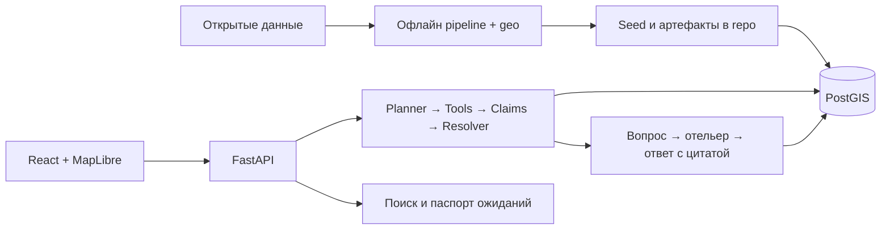

# О!кно — О!дин шаг до идеального отеля

Поиск отелей Сочи по проверяемым характеристикам номера, фасада и этажа. Запрос превращается в понятные условия, каждый результат объясняется доказательствами, а ожидания передаются отельеру в паспорте.

- Видео-скринкаст: **готовится; ссылка обязательна до сдачи**.
- Текущая стадия: Ф0, фундамент. Полная готовность отслеживается в `docs/STATUS.md`.

## Быстрый старт

```sh
git clone <URL-репозитория-команды>
cd <repo>
cp .env.example .env
docker compose up --build
# http://localhost:8080
```

## Зависимости и переменные окружения

Docker Desktop/Engine + Compose ≥2.24. Рекомендовано 4 CPU, 8 ГБ RAM, 10 ГБ диска. В Docker: Postgres 17 + PostGIS 3.6 и Python 3.12/FastAPI, статический React/Vite/MapLibre. Все зависимости публичные и закреплены. Размер app и время чистой сборки будут измерены перед сдачей, не оценены на глаз.

| Переменная | Дефолт |
|---|---|
| APP_PORT | 8080 (внутри и снаружи фиксирован правилами) |
| DB_URL | postgresql://okno:okno@db:5432/okno |
| LLM_BASE_URL | https://api.openai.com/v1 |
| LLM_API_KEY | пусто |
| LLM_MODEL | пусто |
| LLM_MODE | offline |
| LLM_STRUCTURED_MODE | auto |
| LLM_TIMEOUT_S | 12 |

Ключ LLM необязателен. Без него используются детерминированные инструменты, русские правила и офлайн-кэш. Live — OpenAI-compatible endpoint, ключ только в локальном `.env`. LLM не имеет права создавать значения характеристик без evidence.

## Сидирование

Миграции и загрузка заранее подготовленных данных выполняются автоматически до старта HTTP. Пересборка открытых данных — отдельно `make pipeline`; это не требуется для запуска жюри. Формат seed и реестр доказательств: `docs/CONTRACTS.md` §3.

## Маршруты/доступ

- `/` — UI; `/search`, `/hotel/:id`, `/compare`, `/booking/:id`.
- `/hotelier`, `/studio`, `/agent`, `/changes`, `/quality`, `/quality/label`, `/sources`.
- `/health` — 200, `{"status":"ok"}`; `/api/docs` — OpenAPI.
- Тестовый отельер: `hotelier / hotelier123` (демо).

## Данные, лицензии и атрибуции

Используем только открытые данные и ответы отельера. Данные/скрапинг Островка, Booking и других OTA не используются. Фактические источники, даты и лицензии появятся в `data/seed/manifest.json` и `/sources` после верифицированной выгрузки; здесь пока нет утверждения о готовом покрытии.

План источников: OSM/Geofabrik (ODbL), Overture (лицензия каждого набора), Copernicus GLO-30, Open-Meteo (CC BY 4.0), Wikidata (CC0), Commons (по каждому файлу), Ookla (CC BY-NC-SA, некоммерческий прототип), Protomaps (ODbL данные, BSD код). Сырые PBF/DEM не коммитятся. Базовые поля карточки могут быть mock (`mock_basic_card`). Симулятор отельера, оценка спроса, бронь и новая постройка помечаются как синтетические.

## Архитектура



## Метрики и ограничения

`make eval` сформирует отчёт и `/quality`. Точность на реальной разметке пока не измерена. Monte Carlo — устойчивость к неопределённым входам, не доказанная точность модели. Расчёт шума — приближённая наружная модель; шумоизоляцию нужно уточнять у отеля. Высоты зданий могут быть оценены по этажности, Copernicus — DSM с крышами/деревьями. Паспорт — структурированный демо-запрос, бронирование без оплаты.

Проверки и риски: `docs/STATUS.md`. Решения: `docs/DECISIONS.md`. Команды и сдача: `docs/RUNBOOK.md`.

