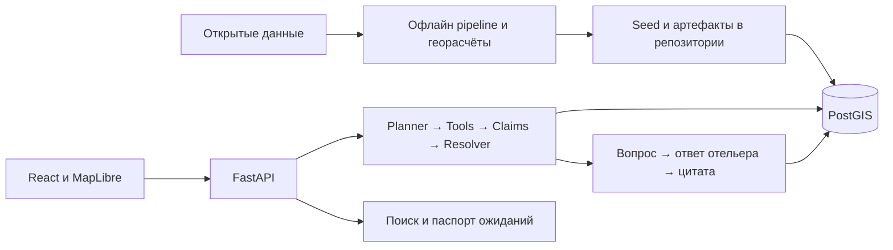

# О!кно — О!дин шаг до идеального отеля

О!кно пересобирает путь «хочу → бронь» в эпоху AI: поиск отелей Сочи по проверяемым характеристикам номера, фасада и этажа. Запрос превращается в понятные условия, каждый результат объясняется доказательствами, а ожидания передаются отельеру в паспорте.

- Видео: `<DEMO_VIDEO_URL>`. Скринкаст записан: около 3 минут, 1920×1080, 30 кадров/с, 11 сцен без ошибок. Локальный файл — `demo/okno-demo.mp4` (около 10 МБ, не входит в Git).
- Работают поиск, георасчёты, доказательства, сравнение, паспорт ожиданий, кабинет отельера, студия характеристик и пересчёт при изменениях. Проверки и оставшиеся пункты — в `docs/STATUS.md`.

## Быстрый старт

```sh
git clone <TEAM_REPOSITORY_URL>
cd <repo>
docker compose up --build
# Открыть http://localhost:8080
```

`.env` необязателен: дефолты запускают offline-демо. Для изменения настроек можно скопировать `.env.example` в `.env`.

## Проверка за 5 минут

После `docker compose up --build`, без ключа LLM:

1. **Поиск.** На главной нажмите «Найти мой отель» с запросом Маши «тихий номер с видом на закат недалеко от моря» или выберите карточку «Закат для двоих». Три отеля попадают в «Подходят по обязательным». У каждого условия видно «да, но»: сторона здания, этаж, оговорки и метка синтетики там, где подтверждение дал симулятор отеля.
2. **Карта.** Наведение на карточку подсвечивает отель. «Показать на карте» строит лучи обзора, заката и пеший маршрут до моря. Слои «Тишина / Закат / Вид / До моря» переключаются, зум — Ctrl/⌘ + колесо.
3. **Отель.** На странице отеля есть фото здания (Wikimedia Commons или сайт отеля, с указанием источника) либо подписанный вид 3D-модели по OSM. Дальше идут блоки «Какой номер просить», «Что может разочаровать» и профиль по характеристикам: таблица заката «фасад × месяц» с этажами, вид на море и горы по сторонам, тишина по фасадам, климат по месяцам. Клик по любому значению открывает источник, метод, дату получения и срок актуальности. «Показать расчёт» показывает горизонт, путь солнца и неопределённость.
4. **Противоречия.** Откройте `/hotel/osm-way-53301256` («Фламинго»). Блок «Где данные спорят»: сайт обещает вид на море, расчёт по фасадам его не находит. Значение не считается подтверждённым, вопрос уже ушёл отелю.
5. **Отельер.** Войдите в кабинет как `hotelier / hotelier123` и выберите вопрос. «Симулировать ответ» (или свой текст и «Разобрать ответ») → поля с дословными цитатами → «Подтвердить поля». Ответ сразу учитывается в поиске для всех гостей.
6. **Паспорт ожиданий.** «Создать паспорт» на странице отеля, затем подтверждение номера в кабинете. Если доказательства истекают раньше конца поездки, паспорт просит перепроверку.
7. **Изменения.** На `/changes` уже лежит синтетический сценарий «рядом построили 16-этажный дом» у «Империи»: было/стало по фасадам и уведомление паспорту. Повторить сценарий для другого отеля можно под `hotelier / hotelier123` (роль `demo_admin`).
8. **Расширение и прозрачность.** В `/studio` выберите «Супермаркет в 5 минутах пешком» → спецификация → пробный прогон → публикация. Без ключа это офлайн-шаблоны для 15 типов мест OSM, с ключом — свободный текст. На `/agent` открыт готовый прогон сбора профиля (36 шагов). На `/quality` — сравнение с фильтром «до моря ≤ 500 м» и происхождение значений.

Ещё запросы: «с собакой 30 кг, нужна парковка», «в гуще событий, бары рядом», «похожий на Cascade», «тихо, море и закат в одном номере, 14–21 сентября», «удалённая работа, быстрый интернет». Последний честно покажет, что данных о связи в демо-регионе нет.

Приёмка из терминала: `make demo-check` проверяет Машу, пять персон, ссылки на доказательства и синтетическое происхождение ответов. `make smoke` дополнительно проходит health → поиск → карточка → сохранённый паспорт → авторизованный кабинет. Для этих локальных команд нужны Python 3.12 и `requirements-dev.lock`; установка описана в `docs/RUNBOOK.md`. Для запуска приложения достаточно Docker. Текущая контрольная точка: 442 теста и 125 subtests прошли; покрытие строк Python — **86%**, 5 060 из 5 864 строк, без каталогов тестов ([coverage.json](docs/checks/coverage.json), `make coverage`). `make check` на этом чистом клоне также прошёл за 33,49 с ([отчёт](docs/checks/make_check_clean_clone_20261026.json)). Результаты pytest, lint и сборки с датой и SHA записываются в `docs/STATUS.md`; они относятся к проверенному коммиту.

## Переиспользование: как встроить в Островок

О!кно можно подключать частями к каталогу, поиску и экстранету. HTTP-контракты описаны в [OpenAPI](http://localhost:8080/api/docs) и [CONTRACTS](docs/CONTRACTS.md). Примеры ниже используют уже загруженный отель; POST-запросы сохраняют обычные локальные прогоны и ответы.

```sh
BASE=http://localhost:8080
HOTEL_ID=osm-node-10058556917
```

**Обогащение контента.** `POST /api/runs` запускает планировщик и разрешённые инструменты для выбранных характеристик. `GET /api/runs/{run_id}` возвращает ход и результат, `GET /api/hotels/{hotel_id}` — материализованные facts, исходные claims и доказательства. Контракт: [runs](http://localhost:8080/api/docs#/runs), [каталог](http://localhost:8080/api/docs#/catalog).

```sh
curl -sS -X POST "$BASE/api/runs" -H 'Content-Type: application/json' \
  -d '{"hotel_id":"osm-node-10058556917","characteristic_ids":["sea_view","sunset_view"]}'
curl -sS "$BASE/api/runs/<run_id>"
curl -sS "$BASE/api/hotels/$HOTEL_ID"
```

**Ранжирование и объяснения поверх поиска.** `POST /api/search` возвращает разобранный запрос, ранжирование, verdicts и ссылки на доказательства. `POST /api/hotels/{hotel_id}/evaluate` применяет отредактированный `ParsedQuery` к одному отелю и возвращает `HotelDetail` с рекомендацией номера. Объяснения входят в ответы этих маршрутов. Контракт: [catalog](http://localhost:8080/api/docs#/catalog).

```sh
curl -sS -X POST "$BASE/api/search" -H 'Content-Type: application/json' \
  -d '{"text":"тихий номер с видом на закат недалеко от моря","limit":20}'
curl -sS -X POST "$BASE/api/hotels/$HOTEL_ID/evaluate" -H 'Content-Type: application/json' \
  -d '{"text":"закат из окна","month":9,"must":[{"characteristic_id":"sunset_view","label":"Закат из окна","value":true}]}'
```

Текущий `/api/search` ранжирует локальный каталог. Для существующей выдачи Островка адаптер должен сопоставить её hotel IDs с внутренними IDs О!кна и применить evaluate к кандидатам; пакетная оценка внешнего списка пока не реализована.

**Виджет вопросов в экстранете.** `POST /api/questions` создаёт или переиспользует вопрос. Кабинет получает его через `GET /api/hotelier/{hotel_id}`; свободный ответ проходит preview через `POST /api/questions/{question_id}/answer`, затем `POST /api/answers/{answer_id}/confirm` сохраняет claims с цитатами. Кабинет, ответ, симуляция и подтверждение проверяют hotel scope Bearer-токена до записи. Контракт: [hotelier](http://localhost:8080/api/docs#/hotelier). В примере используется `demo_admin`; `TOKEN`, `question_id` и `answer_id` заменяются значениями ответов.

```sh
curl -sS -X POST "$BASE/api/hotelier/login" -H 'Content-Type: application/json' \
  -d '{"username":"hotelier","password":"hotelier123"}'
curl -sS -X POST "$BASE/api/questions" -H 'Content-Type: application/json' \
  -d '{"hotel_id":"osm-node-10058556917","characteristic_id":"pets"}'
curl -sS -X POST "$BASE/api/questions/<question_id>/answer" \
  -H "Authorization: Bearer $TOKEN" -H 'Content-Type: application/json' \
  -d '{"text":"Синтетический ответ для демонстрации: принимаем собак до 30 кг за 1000 рублей за ночь.","synthetic":true}'
curl -sS -X POST "$BASE/api/answers/<answer_id>/confirm" -H "Authorization: Bearer $TOKEN"
```

**Актуализация и события.** `POST /api/changes/refresh` перепроверяет истёкшие наблюдения доступными локальными инструментами; этот маршрут и `/api/changes/simulate` доступны только `demo_admin` по Bearer. `GET /api/changes` публично отдаёт события без индивидуальных уведомлений (`notifications=[]`), сохраняя их общее число в `payload.notification_count`. По Bearer admin видит все уведомления, tenant — только связанные со своими отелями. `GET /api/passports/{passport_id}` возвращает состояние и уведомления по гостевой UUID-ссылке. Для прогонов есть SSE `GET /api/runs/{run_id}/stream`; interview-прогоны закрыты по hotel scope. Контракт: [changes](http://localhost:8080/api/docs#/changes), [passports](http://localhost:8080/api/docs#/passports), [runs](http://localhost:8080/api/docs#/runs).

```sh
curl -sS -X POST "$BASE/api/changes/refresh" -H "Authorization: Bearer $TOKEN"
curl -sS "$BASE/api/changes"
curl -sS "$BASE/api/passports/<passport_id>"
curl -N "$BASE/api/runs/<run_id>/stream" -H "Authorization: Bearer $TOKEN"
```

Для production нужен адаптер внешних hotel IDs к `Hotel.id`, координатам и контурам; публичного API импорта отелей пока нет. Цены и номерной фонд следует получать из каталога Островка вместо `mock_basic_card`, а ответы симулятора — заменить ответами авторизованных представителей с сохранением цитат и происхождения. Уже параметризованы регион (`pipeline/regions/*.yaml`), характеристики (`data/characteristics/*.yaml`), OpenAI-compatible LLM и offline-режим. Карта модулей и ограничения интеграции — в [ARCHITECTURE](docs/ARCHITECTURE.md), пользовательская модель — в [PRODUCT](docs/PRODUCT.md).

До эксплуатации нужны доверенное SSO и выдача прав на отели, приватные аккаунты, управляемые ключи и отзыв сессий, долговечная очередь задач, квоты, мониторинг, резервное копирование и правила хранения персональных данных. Реализованная demo-проверка hotel scope не считается production-авторизацией: все пароли, включая admin, публичны. Studio, collect и операции разметки также остаются публичными demo-возможностями, которые нужно ограничить при интеграции. Подробные границы — в [SECURITY](docs/SECURITY.md). Также нужны независимая проверка качества и коммерческая проверка лицензий, включая Ookla.

Полный pipeline Сочи для 250 отелей по стадиям ещё не измерен. Отдельный эксперимент на 30 объектах Геленджика дал реальные замеры и условную оценку 1000 hotel calls, приведённые ниже. Старт приложения за 46 с не является временем сбора или расчёта региона. Рекомендации по ресурсам в следующем разделе относятся к запуску поставленного демо, а не к расчёту произвольного города.

## Зависимости и переменные окружения

Нужны Docker Desktop/Engine и Docker Compose v2 (подходит любая версия v2: настройки передаются интерполяцией `${VAR:-default}`, файл `.env` необязателен). Рекомендовано 4 CPU, 8 ГБ RAM и 10 ГБ диска с учётом сборки. Всё приложение работает в Docker: PostgreSQL 17 с PostGIS 3.6, Python 3.12/FastAPI и собранный интерфейс React/Vite/MapLibre. Версии базовых образов и зависимости закреплены; используются публичные реестры.

Образ приложения: 315 522 627 байт (около 301 MiB), `linux/amd64`, UID 10001. Запуск с пустой БД и готовым образом ранее проверен за 46 с. Snapshot `9ac03ec` проверен из чистого клона: без `.env`, с новым Compose-проектом/пустыми volumes, после `docker builder prune -af`. Ровно `docker compose up --build` дал `/health` через **174,98 с**; полный smoke, 12 demo-check guards и browser preview — **249,07 с**, PASS. В PATH запуска отсутствовали Python и Node; локальные инструменты подключались только для последующей QA. Отчёт: [clean_clone_20261026_noenv.json](docs/checks/clean_clone_20261026_noenv.json). Это замер запуска подготовленного демо, не пересборки региона.

| Переменная | Значение по умолчанию |
|---|---|
| APP_PORT | 8080; порт внутри контейнера и проброс фиксированы |
| DB_URL | postgresql://okno:okno@db:5432/okno |
| LLM_BASE_URL | https://api.openai.com/v1 |
| LLM_API_KEY | пусто |
| LLM_MODEL | пусто |
| LLM_MODE | offline |
| LLM_STRUCTURED_MODE | auto |
| LLM_TIMEOUT_S | 12 |

Ключ LLM необязателен. Основной сценарий работает без сети после сборки: детерминированные инструменты, русские правила и локальный кэш. Для опционального OpenAI-compatible провайдера задайте в локальном `.env` одновременно `LLM_MODE=live`, `LLM_MODEL` и `LLM_API_KEY`; при необходимости измените `LLM_BASE_URL`. LLM не создаёт фактические значения характеристик без доказательств.

## Сидирование

Миграции, загрузка подготовленных данных и построение поискового снимка выполняются автоматически до запуска HTTP. В поставке 250 отелей и 17 спецификаций характеристик. Ещё 1 000 наблюдений о ближайших POI (ночная аптека, детская площадка, парковка и зарядка, «в гуще событий») рассчитываются локально при первом старте по сохранённым открытым данным. При первом старте также выполняются один обычный прогон сбора для «Гамма сириус» (трасса планировщика, инструментов, Resolver и вопросов на `/agent`) и сохранённый синтетический сценарий «новый 16-этажный дом» перед «Империей» (было/стало на `/changes`). Ключи и ручная загрузка данных не требуются.

`make pipeline` отдельно пересобирает открытые данные и георасчёты; для локального запуска он не нужен. Формат seed и реестр доказательств описаны в `docs/CONTRACTS.md` §3.

## Маршруты/доступ

- `/` — главная; `/search`, `/hotel/:id`, `/compare`, `/booking/:id` — путь гостя.
- `/hotelier`, `/studio`, `/agent`, `/changes`, `/quality`, `/quality/label`, `/sources` — кабинет, инструменты и проверка данных.
- `/health` — 200, `{"status":"ok"}`; `/api/docs` — OpenAPI.

| Логин | Публичный пароль демо | Роль и область доступа |
|---|---|---|
| `hotelier` | `hotelier123` | `demo_admin`, все отели и глобальные изменения |
| `cascade` | `cascade-demo-2026` | `hotelier`, только Cascade (`osm-node-11866202895`) |
| `brevis` | `brevis-demo-2026` | `hotelier`, только Brevis apartments (`osm-way-201474330`) |

`POST /api/hotelier/login` принимает `{username,password}` и возвращает `{token,username,synthetic:true,role,hotel_ids}`. Все публичные demo-аккаунты создают только синтетические ответы и `hotelier_simulator` claims, даже если в запросе передано `synthetic=false`. Confidence 0,85 задаётся сервером как prior, а не как измеренная точность.

Private-запросы кабинета и действий с паспортами требуют Bearer. Interview list/detail/SSE также проверяют hotel scope; login устанавливает HttpOnly cookie только для `/api/runs`, чтобы браузерный EventSource мог читать закрытую трассу. `POST /api/hotelier/logout` удаляет эту cookie, UI удаляет локальный токен. Скопированный stateless Bearer остаётся действителен до истечения 12 часов или перезапуска процесса. Каталог и опубликованные цитаты остаются публичными. UUID паспорта — гостевая read capability без отдельного срока или отзыва; знающий ссылку может прочитать паспорт. Подробности — в [SECURITY](docs/SECURITY.md).

## Данные, лицензии и атрибуции

Данные взяты из открытых источников. Данные и скрапинг Островка, Booking и других OTA не используются. Ответы, добавленные симулятором отельера, явно отделены от открытых наблюдений. Источники, даты, SHA-256 и лицензии находятся в `data/seed/manifest.json`, `data/seed/sources.json` и на `/sources`; подробности — в `pipeline/README.md`.

В seed 250 реальных объектов: 175 в центре Сочи и 75 в Адлере–Имеретинке. Географический реестр содержит 20 340 claims, климат, воздух и Commons — 3 364. Дополнительно сохранены 40 коротких цитат с официальных сайтов для слабых меток качества. Внутренние свойства реальных гостиниц не выводятся из их названий или категории.

Использованы OSM/Geofabrik (ODbL), Overture (лицензия каждого набора), Copernicus GLO-30, Open-Meteo (CC BY 4.0), Wikidata (CC0), Commons (лицензия каждого файла), Ookla (CC BY-NC-SA, некоммерческий прототип) и Protomaps (ODbL для данных, BSD для кода). Сырые PBF и DEM не входят в Git. Базовые поля карточки могут быть демонстрационными (`mock_basic_card`). Симулятор отельера, оценка спроса, бронь и новая постройка помечаются как синтетические.

**Фото отелей.** У 46 из 250 отелей есть настоящее фото, каждое проверено вручную. 8 снимков зданий взяты с Wikimedia Commons: они хранятся в репозитории с автором и лицензией (CC BY / CC BY-SA). 38 изображений — с официальных сайтов отелей: в репозиторий они не копируются и показываются по ссылке с подписью «Фото с сайта отеля». Сбор выполнен одноразово офлайн (`scripts/collect_hotel_photos.py`, robots.txt, без OTA), методика — в [docs/checks/hotel_photos.md](docs/checks/hotel_photos.md). Остальным отелям показывается вид их здания на 3D-модели по открытым данным с подписью «3D-модель по OSM · не фото» (`make snapshots`: `scripts/render_building_snapshots.mjs` → `scripts/build_snapshot_index.py`). Такой вид есть у всех 250 отелей и служит запасным вариантом, если ссылка на фото с сайта недоступна (например, стенд без интернета).

**Панорамы.** Кнопка «Панорама рядом» на странице отеля и «Панорама: ‹сторона›» в карточках вида открывают Яндекс Панорамы у отеля, повёрнутые в сторону фасада, — чтобы сверить расчёт вида глазами. Виджет Яндекса загружается только по клику и только при наличии интернета; расчёты О!кна от него не зависят.

Демо-регион интерфейса: **Сочи — центр и Адлер–Имеретинка**. Точные зоны указаны в `pipeline/regions/sochi.yaml` и в интерфейсе. Перенос pipeline проверен отдельно на 30 объектах Геленджика; его крупные выходы не входят в основной seed. Другой регион следует собирать в изолированном каталоге данных: `REGION=pipeline/regions/<region>.yaml` задаёт регион, но не обеспечивает автоматический выбор проекции и всех входов.

### Замер второго региона и оценка ресурсов

В [отчёте Геленджика](docs/checks/region_gelendzhik.md) сохранены параметры, 14 стадий, источники и SHA-256. Результат — 30 реальных исходных объектов размещения, 2 376 geo claims и 418 open-data claims по 8 характеристикам. Ручной проверки окон и полевой точности не было. Основной seed Сочи не изменялся.

| Измерение | Результат и условия |
|---|---|
| Все стадии | 19,02 мин; готовый pipeline-образ и cached PBF, остальные загрузки и обработка включены |
| Георасчёт 30 объектов | 373,25 с одним worker, включая 7,42 с загрузки региона |
| Память | lifetime RSS процесса около 1,81 ГБ; это не пик каждой стадии и не общий пик контейнера |
| Сеть fetch-контейнера | RX около 844 МБ; 12,8 МБ сохранённых bbox SQL-результатов не равны удалённому чтению Parquet |
| 30 пар hotel JSON/NPZ | 43,8 МБ, отдельно от общих сеток, seed, карты, raw и LOS caches |

Среда: Apple M4, 10 CPU, 16 GiB RAM, Docker `linux/amd64` через Rosetta, один worker. Для той же смеси этажности и фасадов среднее 29 прогретых hotel calls — 11,80 с: линейная оценка **3,28 ч на 1000 calls**, бюджет по p90 — **4,84 ч**. Отдельно добавляются подготовка региона (здесь 12,36 мин с cached PBF), холодные загрузки/сборка, валидация и нужные кэши. Файлы пар JSON/NPZ при той же смеси дали бы около 1,46 ГБ на 1000 объектов плюс общие данные. Это оценка порядка затрат по небольшому эксперименту, не прогон 1000 отелей, не SLA и не замер ускорения от нескольких workers.

Перенос сейчас ограничен зонами A/B и зафиксированной EPSG:32637, подходящей Сочи и Геленджику. Для Геленджика потребовались явный terrain bbox, правильные DEM tiles N44E037/038 и явный hotel ID для LOS cache вместо defaults Сочи. Глобальный автоматический выбор проекции, береговой маски и кэшей не реализован; ограничения подробно перечислены в отчёте.

### Синтетические демонстрационные сценарии

В поставке три вымышленных ответа о тишине в сентябре: Cascade — юго-западный фасад, 3-й этаж; Приморская — западный фасад, 5-й этаж; Brevis — западный фасад, 7-й этаж. Они имеют `synthetic=true`, `evidence.kind=simulation`, точную цитату и публичный реестр `data/seed/demo_hotelier_claims.jsonl`. Это **не реальные ответы гостиниц и не измерение тишины**. Confidence исходного claim — 0,85; итогового факта после согласования Resolver — около 0,69. Исходная модель внешнего шума сохраняет confidence 0,38.

Закат и пеший маршрут этих отелей рассчитаны по открытым данным. Маршрут с confidence около 0,66 остаётся предварительной оценкой. В сценарии Маши три отеля попадают в группу «все обязательные»: группа допускает ✓ или ≈ с confidence ≥0,6 и совместимыми условиями номера. Неизвестные ограничения туда не попадают. Без дат показано предположение «Сентябрь (по умолчанию) — укажите даты».

Также включены семь завершённых синтетических диалогов о питомцах и два вопроса для прохождения петли в кабинете. В `data/seed/demo_hotelier_dialogues.json` сохранены вопросы, свободные ответы, разобранные поля, подтверждённые ответы симулятора, claims и трассы. Это не подтверждения от реальных отелей. Парковка рядом рассчитывается отдельно по открытым данным и не доказывает наличие собственной парковки или возможность въезда.

## Как решение закрывает кейс

| Пункт кейса | Где реализуется | Как проверить |
|---|---|---|
| Ожидаемый результат: найти подходящий отель региона | `/search`, 250 объектов Сочи | Свободный запрос → ранжированные карточки |
| 1. Сбор характеристик | `geo/`, `pipeline/`, реестр инструментов, Planner | `/agent`: инструмент → claim → доказательство |
| 2. Диалог с отельером | Interviewer, AnswerParser, `/hotelier` | Вопрос → свободный ответ → цитаты → подтверждение симулятора |
| 3. Хранение и достоверность | PostgreSQL, Resolver | Источник, метод, confidence, срок действия, разбор условий фасада/этажа; противоречия источников помечаются спорными и порождают вопрос отельеру |
| 4. Расширяемость | YAML-спецификации, `/studio` | «В гуще событий» добавлена одним YAML-файлом; в студии офлайн-шаблоны «<место> рядом / в N минутах / ближе N м»: компиляция → пробный расчёт → публикация → новый чип |
| 5. Поиск своими словами | QueryUnderstanding, Ranker, `/search` | Русский запрос и редактирование обязательных и желательных условий |
| Доп. 1: объяснения | Explainer, карточки и `/hotel/:id` | По каждому условию ✓ / ≈ / ✗ / ? с доказательствами |
| Доп. 2: сравнение | `/compare` | 2–4 отеля, различия и уверенность |
| Доп. 3: кабинет | `/hotelier` | Подтверждение или исправление создаёт новый claim с цитатой |
| Доп. 4: актуализация | FreshnessWatcher, `/changes` | Сроки действия и синтетический новый дом с географическим пересчётом |
| Доп. 5: метрики | `make eval`, `/quality`, `/quality/label` | Методика, слабые метки и отдельные результаты синтетических тестов |

## Безопасность зависимостей

`make check` запускает lint, тесты, аудит и smoke уже работающего Compose. `make audit` проверяет четыре Python lock-файла с хэшами: runtime, разработку и два окружения pipeline; ещё три скана покрывают npm production, полный frontend и запись демо. Аудит блокирует известные Python-уязвимости и npm High/Critical. Сбой сканера не считается успехом.

26.10.2026 все семь сканов завершились без известных уязвимостей и ошибок сканера. Дата, результаты и хэши находятся в `docs/audits/summary.json`; отчёт относится к указанным lock-файлам, а не является гарантией отсутствия будущих уязвимостей.

GitHub Actions в организации хакатона недоступны из-за биллинга. Workflow оставлен только для ручного запуска через `workflow_dispatch`, без push/PR-триггеров. Он использует dev lock, собирает Docker и запускает smoke вместе с demo-check. Локальные результаты и состояние проверки чистого клона — в `docs/STATUS.md`.

## Архитектура

Карта модулей, четыре сквозные цепочки и алгоритмы с допущениями: [docs/ARCHITECTURE.md](docs/ARCHITECTURE.md). Модель продукта, UX и контракты: [docs/PRODUCT.md](docs/PRODUCT.md).



## Метрики и ограничения

### Чем модельный поиск дополняет фильтр расстояния

В [filter_baseline.json](data/eval/filter_baseline.json) сравниваются 250 отелей: фильтр ≤500 м по прямой до картированной береговой линии и условие «море **и** закат в одном совместимом номере» для сентября. Использованы только несинтетические geo/open seed, штатные Resolver и evaluator; ответы симулятора и runtime-сценарии исключены. Это сравнение сохранённой модели, не измерение реальных окон, конверсии или полевой точности.

| Результат на snapshot | Отелей |
|---|---:|
| Прошли фильтр ≤500 м | 132 |
| Модель поддерживает море и закат в совместимом scope | 60 |
| Из них находятся за пределами 500 м и были бы отсечены фильтром | 20 |
| Из 60 поддержанных вариантов имеют предварительное выполнение с confidence ≥0,6 | 14 |

Среди 132 прибрежных вариантов морской вид поддержан моделью у 57, модельный отрицательный вывод — у 3, неизвестно — у 72. Для заката соответствующие числа — 44, 5 и 83. Unknown не приравнивается к отсутствию вида. Строгий модельный вывод «закат только с 5-го этажа или выше» получен для 6 отелей, «только с одного фасада» — для 4; он требует достаточного покрытия исключённых scope и уверенных отрицательных расчётов, но всё равно не является инвентаризацией окон.

Метод, пороги, ограничения и SHA-256 входов сохранены в JSON. Воспроизведение: `python -m scripts.compare_filters --month 9 --k-floor 5 --confidence-floor 0.6 --radius 500`. На `/quality` и `GET /api/quality` этот отчёт доступен как `filter_comparison`; доли происхождения данных — отдельно в `provenance`.

### Происхождение значений и разметка

`provenance.unit=materialized_facts` считает текущие известные факты, включая отдельные фасады, этажные диапазоны и месяцы. Знаменатель доли синтетики — `known = non_synthetic + synthetic`; unknown, stale, disputed и пустые значения исключены. `mixed` является подмножеством synthetic: факт со смешанной опорой не увеличивает несинтетическую долю. Это **доля материализованных значений**, а не доля отелей, полнота каталога или точность модели. Несинтетическое происхождение само по себе не означает полевую проверку. Runtime-публикации, ответы и истечение TTL могут менять эти числа; актуальный снимок возвращает `GET /api/quality`.

В [чистом отчёте seed](data/eval/results.json) известно 23 732 materialized facts: 23 722 несинтетических и 10 синтетических, в том числе 3 mixed. Доля synthetic — **10 / 23 732 ≈ 0,0421%**, несинтетических — около 99,9579%; ещё 2 402 неизвестных, устаревших, спорных или пустых значений исключены из этого знаменателя. Это версионированные реестры без runtime-only POI, публикаций студии и действий пользователей; доля текущего стенда после демонстрации может отличаться.

`make eval` воспроизводит `data/eval/results.json` из версионированных реестров; `/quality` дополнительно учитывает локальные POI и ручные действия. Синтетические факты не увеличивают реальное покрытие. Есть 40 слабых меток официальных сайтов для 40 разных объектов; четыре метки парковки ограничены по смыслу и не подтверждают все условия въезда. Независимых ручных меток — 0. nDCG, полевая точность и калибровка не измерены; диагностические результаты на слабых метках не выдаются за точность на реальных проверках.

Сайты собраны отдельным разовым этапом подготовки данных с проверкой `robots.txt` до страниц и после смены origin при редиректе; OTA, включая Островок, заблокированы. Воспроизведение curated-меток и оценка выполняются офлайн по сохранённым фрагментам. Runtime не загружает сайты гостиниц. Методика и границы частичных меток — в [data/eval/README.md](data/eval/README.md).

Различия условий фасадов и этажей показаны отдельно от противоречий: в текущем наборе 101 квалификация области действия, пересекающиеся диапазоны обрабатываются Resolver. Настоящих противоречий источников — 4. У «Фламинго» и «Гамма сириус» сайт заявляет вид на море, а расчёт видимости не находит его ни с одного рассчитанного фасада (каждый вывод с confidence ≥ 0,6). У «Паруса» и «Sunrise» сайт пишет о 300–400 м до пляжа, а пешеходный маршрут по OSM — 1 042 и 824 м. Такие факты помечаются спорными, поиск их не подтверждает, отельеру автоматически уходит вопрос с причиной `conflict`, а примечание цитирует обе стороны. Подтверждённых флагов конфликта высоты — 0; сравнение с моделью, использующей ту же высоту OSM, не считается независимой проверкой.

Monte Carlo показывает устойчивость к неопределённым входам, а не доказанную точность модели. Шум — приближённая наружная модель; шумоизоляцию нужно уточнять у отеля. Высоты зданий могут оцениваться по этажности, Copernicus — DSM с крышами и деревьями. В срезе Ookla 2026Q3 для зон демо всего 3 тайла, и ни один не покрывает отель; Wikidata связана с одним отелем без сведений об истории. Поэтому `/api/status` помечает «Связь для работы» и «Историю здания» как «нет данных в регионе», а поиск сообщает об этом и не ранжирует по ним. Фото Commons показывают окрестности с атрибуцией и не доказывают вид из окна.

Паспорт — структурированный демонстрационный запрос. Бронирование синтетическое, без оплаты; уведомления локальные, письма и сообщения гостиницам не отправляются. Текущие доказательства не гарантируют условия на будущие даты поездки.

Проверки и риски: `docs/STATUS.md`. Решения: `docs/DECISIONS.md`. Команды и порядок сдачи: `docs/RUNBOOK.md`.
