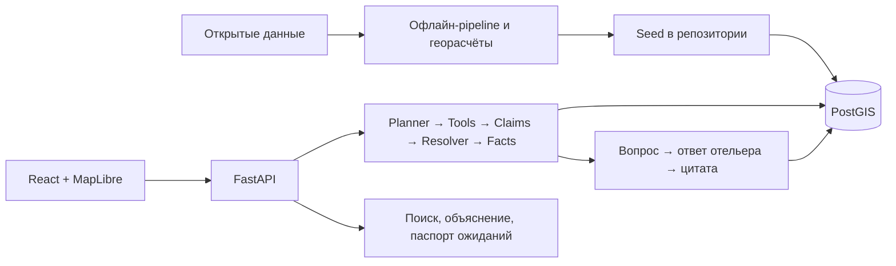

# О!кно — команда SAMARKAND (трек «О!дин шаг до идеального отеля»)

О!кно находит в Сочи не просто отель, а номер под запрос гостя: «тихий номер с видом на закат недалеко от моря». Агенты считают по открытым геоданным, что видно из окна и что слышно с каждой стороны, на каком этаже и в каком месяце. Чего нет в данных, они спрашивают у отельера. У каждого вывода есть источник, уверенность и срок годности.

- **Видео (до 5 минут):** `<DEMO_VIDEO_URL>`
- **Презентация:** [docs/presentation.pdf](docs/presentation.pdf)
- **Команда SAMARKAND:** Глеб Кашин, Марк Закон, Фёдор Ведерников, Егор Ожигов, Матвей Панин
- Развёрнутого сервиса нет, проект запускается локально одной командой.

## Быстрый старт

```sh
git clone https://github.com/ostrovok-hackathon-2026/samarkand.git
cd samarkand
docker compose up --build
# открыть http://localhost:8080
```

- `.env` и ключи не нужны. Всё работает офлайн на заранее собранных данных из репозитория. При желании настройки можно поменять: `cp .env.example .env`.
- С чистого клона и пустым кэшем сборки сервис отвечает на `/health` через 2–3 минуты: в последнем замере 128 с на Apple M4, без `.env` ([отчёт](docs/checks/final_clean_clone.json)).
- Остановить: `docker compose down`. Сбросить демо-данные к исходным: `docker compose down -v`, затем снова `docker compose up --build`.

## Что умеет

| Задача кейса | Что сделано |
|---|---|
| Сбор характеристик | 39 характеристик описаны в YAML. Планировщик сам выбирает инструменты: видимость по рельефу и зданиям, положение солнца, шум по сторонам, пеший маршрут с перепадом высот, OSM, климат. Ход сбора с источниками открыт на `/agent`. |
| Диалог с отельером | Если данных нет, они неточные или источники спорят, создаётся вопрос отелю. Свободный ответ раскладывается по полям, у каждого поля есть дословная цитата. Отельер подтверждает разбор, ответ виден всем гостям. Отельера можно имитировать. |
| Хранение и достоверность | PostgreSQL/PostGIS. Каждое утверждение (claim) обязано иметь источник, метод, доказательство, уверенность, дату и срок годности, иначе база его не примет. Противоречия источников помечаются спорными и порождают вопрос отельеру. |
| Расширяемость | Новая характеристика — это YAML-файл или текст в `/studio`, например «супермаркет в 5 минутах пешком». Дальше пробный расчёт и публикация, код переписывать не нужно. |
| Поиск своими словами | Фраза превращается в обязательные и желательные условия. Их можно править. Условия проверяются вместе для одного номера: сторона, этаж, месяц. |
| Объяснение, сравнение, кабинет, актуализация, метрики | ✓ / ≈ / ✗ / ? по каждому условию с доказательством; сравнение 2–4 отелей на `/compare`; кабинет отельера; пересчёт видимости после «новой постройки» с уведомлением гостю; страница `/quality` с методикой. |

**Результат на данных** (сентябрь, 247 отелей). Фильтр «до моря ≤ 500 м» пропускает 131 отель. Номер, где море и закат видны из одного окна, по расчёту есть у 54 отелей, и 18 из них такой фильтр отсёк бы. Ещё 4 расхождения с сайтами отелей: у «Фламинго» и «Гамма сириус» вид на море заявлен, но ни с одного фасада не просматривается; «Парус» и «Sunrise» пишут о 300–400 м до пляжа, а пешком выходит 1 042 и 824 м. Метод и ограничения описаны в [filter_baseline.json](data/eval/filter_baseline.json).

## Проверка за 5 минут

1. **Поиск.** На главной нажмите «Демо-запрос» («тихий номер с видом на закат недалеко от моря»): при пустом поле поиск начнётся сразу. Сверху окажутся отели, где обязательные условия совпадают в одном номере. Значок «≈» означает расчётную оценку, а не подтверждение отеля. Чипы условий можно изменить.
2. **Карта.** «Показать на карте» строит лучи обзора, линию заката и пеший маршрут до моря. Слои: «Тишина», «Закат», «Вид», «До моря».
3. **Отель и номер.** Блок «Какой номер просить» называет сторону и этаж, например «западная сторона, 5-й этаж: закат из окна». «Проверить окно» меняет сторону, этаж и месяц, «Показать расчёт» выводит горизонт и путь солнца. Источники, методы, даты и ограничения раскрываются по кнопке «Для дотошных».
4. **Противоречия.** На `/hotel/osm-way-53301256` («Фламинго») есть блок «Где данные спорят»: сайт обещает вид на море, а расчёт его не находит. Вопрос отелю уже стоит в очереди кабинета.
5. **Кабинет отельера.** Войдите как `hotelier / hotelier123`. Выберите вопрос, нажмите «Симулировать ответ» или напишите свой, потом «Разобрать ответ». Разбор покажет поля с цитатами, «Подтвердить и показать гостям» опубликует ответ. Демо-ответы подписаны «Ответ отеля · демо» и не выдаются за реальное подтверждение.
6. **Паспорт ожиданий.** На странице отеля нажмите «Создать паспорт», затем подтвердите номер в кабинете. Сторона, этаж, месяц и комментарий отеля сохраняются.
7. **Изменения.** На `/changes` разобран демо-сценарий «рядом построили 16-этажный дом»: видимость по фасадам до и после, плюс уведомление гостю с паспортом.
8. **Расширение.** В `/studio` выберите «Супермаркет в 5 минутах пешком»: спецификация → пробный прогон → публикация → новый чип в поиске.
9. **Прозрачность.** Служебные страницы собраны в меню «Для команды»: `/agent` (ход сбора), `/quality` (метрики и сравнение с фильтром), `/sources` (источники и лицензии).

Ещё запросы: «с собакой 30 кг, нужна парковка», «в гуще событий, бары рядом», «круглосуточный магазин рядом», «вид на Морской вокзал», «родителям тихий номер, нам вид на горы, всем до пляжа не больше 10 минут». Полный сценарий со всеми деталями описан в [docs/DETAILS.md](docs/DETAILS.md#подробный-сценарий-проверки).

## Зависимости и переменные окружения

Рекомендованные ресурсы: 4 CPU, 8 ГБ RAM, 10 ГБ диска с учётом сборки. Нужны только Docker и Docker Compose (проверено на Docker 29.4 / Compose 5.1).

Сервисы в `docker-compose.yml`:

- `db` — PostgreSQL 17 + PostGIS 3.6 (`postgis/postgis:17-3.6`);
- `app` — один образ: Python 3.12 / FastAPI и собранный интерфейс React + MapLibre. Сборка multi-stage, образ около 321 МиБ, `linux/amd64`, процесс под непривилегированным пользователем `10001`.

Кэш и очереди не используются. Версии образов и зависимостей закреплены, lock-файлы с хэшами, все реестры публичные.

| Переменная | По умолчанию | Назначение |
|---|---|---|
| `APP_PORT` | `8080` | порт приложения (проброс `8080:8080` фиксирован) |
| `DB_URL` | `postgresql://okno:okno@db:5432/okno` | подключение к БД |
| `LLM_MODE` | `offline` | `live` включает LLM-разбор запросов |
| `LLM_BASE_URL` | `https://api.openai.com/v1` | любой OpenAI-совместимый провайдер |
| `LLM_API_KEY` | пусто | ключ провайдера |
| `LLM_MODEL` | пусто | модель |
| `LLM_STRUCTURED_MODE` | `auto` | `native`, `json` или `prompted` |
| `LLM_TIMEOUT_S` | `12` | таймаут запроса к LLM |

**LLM не нужна.** Разбор запросов и ответов работает на правилах русского языка, все факты считают детерминированные инструменты. LLM можно включить для разбора необычных формулировок: задать `LLM_MODE=live`, `LLM_MODEL` и `LLM_API_KEY`. Её предложение проверяется правилами и само факты не создаёт. Мы проверили GigaChat-3-Ultra (Сбер) и локальную qwen2.5:3b через Ollama. Точность разбора не выросла, а каждый запрос стал дольше на 2 секунды. Поэтому по умолчанию LLM выключена и ключ жюри не нужен.

## Данные и сидирование

Сидирование автоматическое. При старте `app` применяет миграции, загружает данные из `data/` и строит поисковый снимок, ручных команд нет. Повторить загрузку в работающем стенде можно командой `make seed` (`docker compose exec app python -m backend.seed`).

Что лежит в репозитории:

- **Регион — Сочи:** центр и Адлер–Имеретинка. В каталоге 250 объектов (175 + 75), в поиске 247: три записи отложены до проверки адреса или координат.
- **Факты:** около 54 тыс. значений по фасадам, этажам и месяцам; 99,7 % из открытых данных, синтетика подписана.
- **Источники:** OpenStreetMap / Geofabrik (ODbL), Overture Maps, Copernicus DEM GLO-30, Open-Meteo (ERA5, CAMS; CC BY 4.0), Wikidata (CC0), Wikimedia Commons, Ookla Open Data, Protomaps, официальные сайты отелей (короткие цитаты, ссылки на фото). Лицензии, даты снимков и SHA-256 указаны в `data/seed/manifest.json` и на `/sources`.
- **Чего нет:** данных и скрапинга Островка, Booking и других агрегаторов. Ключи Яндекса и 2ГИС не используются, цены и номерной фонд не выдумываются.

**Как отбирали отели.** Сборщик нашёл в двух зонах 844 кандидата из OSM и Overture. В демо вошли 250 по фиксированному правилу: категория «отель», совпадение в двух источниках, наличие объекта OSM. Это 94 из 110 отелей OSM с названием в центре и 74 из 188 в Адлере–Имеретинке; остальные 594 объекта, включая гостевые дома, отложены лимитом. Регион расширяется параметром `hotel_limit` в `pipeline/regions/sochi.yaml` и командой `make pipeline` с сетью. Для оценки затрат мы прогнали весь pipeline на 30 отелях Геленджика: 19 минут. В один поток это около 3,3 часа на 1000 отелей.

**Фото.** Обложки есть у 41 отеля: 8 со свободной лицензией с Викисклада и 33 со страниц официальных сайтов (только ссылкой, с подписью). Ещё у 33 отелей есть галерея номеров. У остальных показывается «Схема района, не фото» и кнопка «Фото и отзывы на Яндекс Картах», которая открывает внешний поиск только по клику. Других открытых фото с надёжной привязкой к отелю мы не нашли. На Викискладе остались три снимка 2007 года без геометок, в Panoramax по нашим зонам два кадра, API KartaView не работает, а Mapillary требует отдельного токена. В продукте Островка фото берутся из его каталога.

Пересборка данных из сети не нужна для запуска и делается отдельно: `make pipeline` (OSM, рельеф, георасчёты) и `make tz-pipeline` (дополнительные слои). Подробности — в [pipeline/README.md](pipeline/README.md).

## Маршруты и доступ

- `/` — главная и поиск; `/search`, `/hotel/:id`, `/compare`, `/booking/:id` — путь гостя.
- `/hotelier` — кабинет отельера.
- «Для команды»: `/studio`, `/agent`, `/changes`, `/quality`, `/quality/label`, `/sources`.
- `/health` — `200 {"status":"ok"}`; `/api/docs` — OpenAPI.

| Логин | Пароль | Роль |
|---|---|---|
| `hotelier` | `hotelier123` | администратор демо: все отели, сценарий «новый дом» |
| `cascade` | `cascade-demo-2026` | отельер Cascade |
| `brevis` | `brevis-demo-2026` | отельер Brevis apartments |

Пароли публичные и нужны только для демо. Ответы из демо-аккаунтов сохраняются как синтетические.

## Как устроено



- **Planner** по YAML-описанию характеристики выбирает инструменты из белого списка.
- **Tools** — это детерминированные расчёты: видимость по цифровой модели рельефа и высотам зданий, положение солнца по месяцам, шум от дорог, железной дороги и баров по сторонам здания, пеший граф OSM с перепадом высот, климат.
- Каждый результат — неизменяемый **claim**. **Resolver** сводит claims в факты с учётом области (сторона, этаж, месяц), веса источника и срока годности. Противоречие источников превращается в вопрос отельеру.
- **Поиск** разбирает фразу в условия и проверяет их вместе для одного номера. **Explainer** объясняет каждое условие со ссылкой на доказательство.

Модули и алгоритмы описаны в [ARCHITECTURE](docs/ARCHITECTURE.md), API — в [CONTRACTS](docs/CONTRACTS.md) и `/api/docs`, способы встроить решение в Островок — в [DETAILS](docs/DETAILS.md#переиспользование-как-встроить-в-островок).

## Качество

| Что мерили | Результат | Как понимать |
|---|---|---|
| Разбор запросов, авторский набор | 248 из 271 точно; 0 ложных условий на 131 ловушке | набор составлен нами и использовался при разработке |
| Разбор запросов, закрытый набор | 33 из 60 | набор не видели до замера; это честный предел обобщения |
| Происхождение фактов | 99,7 % из открытых данных | синтетика подписана и не считается подтверждением |
| Поиск | p95 = 112 мс | один стенд, прогрев, без параллельной нагрузки |
| Автотесты | 2 300+ тестов и 20 браузерных сценариев | все проходят на чистом клоне ([отчёт](docs/checks/final_clean_clone.json)) |

Команды: `make parser-eval`, `make group-parser-eval`, `make ranking-eval`, `make eval`. Методика описана на `/quality` и в [DETAILS](docs/DETAILS.md#метрики-и-ограничения).

## Что не доделано и как доделать

| Сейчас | Как закрыть |
|---|---|
| Незнакомые формулировки разбираются неполно (33 из 60) | Логи реальных запросов → новые правила. LLM проверили, выигрыша нет. |
| Ответы отельеров в демо синтетические, с пометкой | Подключить экстранет Островка: настоящие ответы с цитатой вместо симулятора. |
| Расчёт окон не проверен в поле | Фото гостей и отельеров по номерам → калибровка уверенности. |
| Один регион, в Адлере 75 отелей из ~190 | Увеличить `hotel_limit` или добавить регион YAML-файлом и запустить `make pipeline`. |
| Фото есть у 41 отеля из 250 | Брать фото из каталога Островка при интеграции. |
| Гостевой и служебный интерфейсы объединены для простоты демо | Разделить при встраивании: гостю — вывод, команде — качество данных. |
| Демо-авторизация с публичными паролями | Нужны SSO, права на отели и отзыв сессий ([SECURITY](docs/SECURITY.md)). |

## Для разработчиков

`make up`, `make down` и `make seed` управляют стендом. `make check` запускает линтер, тесты, аудит зависимостей и smoke против запущенного стенда. Для проверок нужны Python 3.12 и `requirements-dev.lock`, порядок описан в [RUNBOOK](docs/RUNBOOK.md). CI (`.github/workflows/ci.yml`) запускается вручную, потому что Actions в организации недоступны.

Документация:

- [DETAILS](docs/DETAILS.md) — данные, метрики, ограничения;
- [REQUIREMENTS_CHECKLIST](docs/REQUIREMENTS_CHECKLIST.md) — построчная сверка с ТЗ и правилами;
- [TZ_COVERAGE](docs/TZ_COVERAGE.md) — покрытие примеров кейса;
- [ARCHITECTURE](docs/ARCHITECTURE.md), [PRODUCT](docs/PRODUCT.md), [DECISIONS](docs/DECISIONS.md), [STATUS](docs/STATUS.md).

Иллюстрации в интерфейсе (`frontend/public/illustrations/`) декоративные и сгенерированы. Они не изображают реальные отели.
